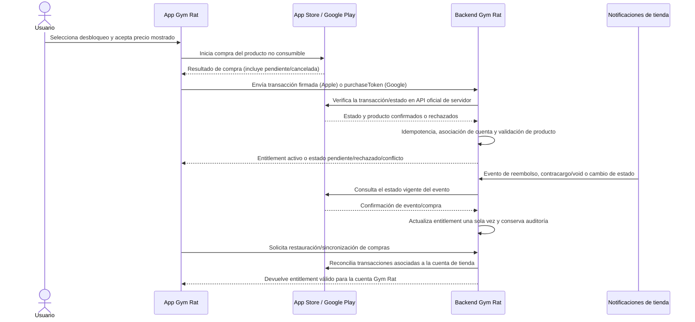

# ADR-003 — Desbloqueo completo mediante pago único

- **Estado:** pago único adoptado; precios MXN aprobados por Producto y registrados en GRT-048; implementación por storefront pendiente de GRT-003.
- **Fecha:** 12 de noviembre de 2026.
- **Supersede:** el modelo de suscripción de ADR-001. ADR-001 conserva sus decisiones de tienda y backend que no contradigan este ADR.
- **Mercado:** México; precios en MXN.
- **Proveedor de catálogo/video:** MuscleWiki seleccionado por ADR-004; planes pagados permiten display/streaming comercial dentro de la app propia. El acceso a medios de terceros depende del servicio activo y no forma parte de una promesa de disponibilidad perpetua.

## Decisión

Gym Rat no ofrecerá suscripciones recurrentes en el MVP. La dirección comercial será un pago único no consumible que habilita permanentemente las funciones propias de Gym Rat incluidas en el SKU. La presentación de medios de terceros estará disponible mientras el proveedor/API, el plan contratado y los términos vigentes lo permitan; no prometer disponibilidad perpetua/offline. Producto aprobó los precios en GRT-048: MXN $399 durante las primeras 100 compras o los primeros 60 días de beta abierta, lo que ocurra primero; después, MXN $699 estándar. GRT-002 completa la matriz Free/desbloqueo y documenta evidencia de comportamiento de compra antes de congelar el paywall.

La compra móvil se procesará en las tiendas: Apple In-App Purchase como producto **non-consumable** en iOS y Google Play Billing como producto digital de compra única en Android distribuido por Play. No habrá checkout web en el MVP. El backend validará la transacción de servidor, asociará el entitlement permanente a la cuenta Gym Rat, hará idempotentes las notificaciones, permitirá restaurar/sincronizar el acceso y revocará el entitlement correspondiente ante un reembolso/contracargo confirmado. No se almacenarán datos de tarjeta.

## Flujo de compra y sincronización

Si una compra ya está asociada a otra cuenta Gym Rat, no moverla ni conceder un segundo entitlement automáticamente; mostrar un conflicto recuperable y dirigir a soporte. En Google, las compras pendientes no reciben acceso hasta pasar a `PURCHASED`; una compra no consumible validada debe reconocerse en el backend dentro del plazo del proveedor. En Apple, usar transacciones firmadas/App Store Server API y App Store Server Notifications V2; no basar el diseño nuevo en el endpoint legado `verifyReceipt`.

## Oferta introductoria por tienda

Apple permite programar cambios temporales de precio para In-App Purchases con fechas de inicio y fin. Google Play admite ofertas de descuento en productos de compra única con fechas y límite de compra por usuario. Las fuentes oficiales consultadas no documentan un límite automático y coordinado de **100 ventas totales entre ambas tiendas**. Para respetar la oferta aprobada, Operaciones debe contar compras pagadas agregadas de ambas tiendas y desactivar el precio/oferta de $399 al llegar a 100 o al cumplirse 60 días, lo que ocurra primero. La desactivación es operativa y podría tener retraso/ventas concurrentes; GRT-026 debe verificar la configuración y los estados en sandbox. Si se exige un tope global estricto sin sobrepasos, reemplazar la condición de 100 por una ventana de 60 días requerirá nueva aprobación de Producto.

## Viabilidad en tiendas

El modelo es técnicamente posible. Apple indica que el contenido/funcionalidad digital que desbloquea funciones debe usar In-App Purchase y contempla productos no consumibles adquiridos una vez y sin expiración. Google Play Billing admite productos digitales de compra única y la política exige su facturación para el acceso a funciones/contenido digital salvo excepciones aplicables. Gym Rat seguirá la compra nativa estándar y no dependerá de excepciones regionales.

Fuentes oficiales:

- [Apple App Review Guidelines, 3.1.1](https://developer.apple.com/app-store/review/guidelines/)
- [Apple In-App Purchase types](https://developer.apple.com/help/app-store-connect/reference/in-app-purchases-and-subscriptions/in-app-purchase-types)
- [Google Play: Understanding Payments policy](https://support.google.com/googleplay/android-developer/answer/10281818?hl=en)
- [Google Play Payments policy](https://support.google.com/googleplay/android-developer/answer/9858738?hl=en)

## Derechos de los medios y bloqueo de uso

El archivo de términos GymVisual compartido por Producto (12 nov 2026) admite en 6.1 usar medios no marcados comprados para ilustrar apps iOS/Android, sujeto a las restricciones de 6.2. La cláusula 6.2 prohíbe el uso en servicios *on-demand*, además de reventa/redistribución y productos destinados a reventa; la cláusula 5 limita la licencia al titular de cuenta y prohíbe transmitirla.

Un pago único no elimina esa restricción: el acceso al contenido multimedia dentro de una app después de desbloquearlo podría seguir siendo uso *on-demand* o distribución a usuarios. La frase de checkout “You will receive download links after payment” describe cómo el comprador recibe los archivos; por sí sola no concede permiso para ofrecerlos a usuarios finales ni prevalece sobre las restricciones de la licencia.

**No integrar ni distribuir los GIF/imágenes GymVisual con la licencia estándar actual** hasta que se cumpla una de estas vías:

1. GymVisual entrega autorización escrita o licencia adicional que prevalezca sobre 6.2 y permita expresamente el modelo de pago único, el acceso por usuarios finales, las apps iOS/Android, el uso de los activos comprados, entrega/visualización, caché/CDN, atribución, territorio y vigencia/acceso permanente; o
2. Gym Rat usa una fuente alternativa cuya licencia cubra explícitamente esos mismos usos.

Mientras no haya autorización aplicable, limitar el catálogo a datos e instrucciones con uso autorizado y diferir los medios conforme a AGENTS.md. No producir medios propios para el MVP sin una decisión explícita.

### Alternativa ExRx revisada

La página y FAQ de Trainer ClipArt compartidas por Producto (12 nov 2026) indican un paquete de más de 1,500 imágenes JPG por USD 119, pero también dicen expresamente que la licencia no permite mostrar/republicar sus imágenes en software o apps. **Trainer ClipArt no es un sustituto licenciado para Gym Rat.** La FAQ recomienda Exercise API para integrar contenido en apps; se evaluará por separado tras recibir cotización y términos que cubran pago único, usuarios finales, display/streaming, caché/CDN, contenido, idiomas, atribución, límites y continuidad del acceso. No se usarán los archivos del paquete bajo la licencia ClipArt.

La página ExRx Premium compartida por Producto anuncia $7 USD cada cuatro semanas o $49 USD anual, con renovación automática, para acceso al contenido del sitio y su propio web app. No es una licencia de integración ni acredita derechos para republicar contenido en Gym Rat. No contratar esta membresía como fuente multimedia.

La FAQ de Exercise API compartida por Producto identifica una vía licenciada para apps:

- **Economy:** campos limitados (nombre, músculo objetivo, aparato y miniatura) con un botón en cada ejercicio que envía al usuario al detalle de ExRx en el navegador. ExRx describe como compensación el tráfico referido. Puede reducir costos recurrentes, pero no ofrece la experiencia completa dentro de Gym Rat.
- **Premium:** todos los campos, videos, miniaturas, instrucciones y metadatos mediante cuotas mensuales. Un developer tier gratuito tiene límite de llamadas y podría devolver errores al excederlo; no se asume adecuado para producción.

No se elige todavía ninguna modalidad. Solicitar cotización y términos para Gym Rat (app iOS/Android, desbloqueo de pago único, volumen de llamadas/usuarios, medios y campos permitidos, idiomas, caché/CDN/offline, atribución, límites/overages, SLA, terminación y continuidad de acceso). Premium solo procede si el precio único y la reserva financiera cubren el costo recurrente; Economy solo procede si Producto acepta que el detalle de los ejercicios se abra fuera de la app.

Los términos de uso de ExRx compartidos por Producto (última actualización indicada: 10 ago 2026) prohíben scraping y copia manual, además de reconstruir su biblioteca mediante nombres/URLs; permiten guardar ejercicios individuales y sus URLs solo dentro de rutinas originales propias. También restringen enlaces a páginas enmarcadas y enlaces directos a archivos de imagen. Por tanto, no poblar el catálogo copiando la biblioteca pública. Economy debe enlazar a páginas ExRx en un navegador con URL/navegación visibles, de acuerdo con el flujo que describe su FAQ. Premium requiere que su acuerdo API conceda expresamente derechos para mostrar contenido de ExRx dentro de Gym Rat y defina caché/CDN/uso offline. La página general de Terms of Use no sustituye ese acuerdo de contenido.

### Alternativa AthleteKit API revisada (13 nov 2026)

La [documentación pública de AthleteKit](https://docs.athletekit.dev/) describe una API de solo lectura para más de 1,177 movimientos y programas estructurados, con metadatos de ejercicio y descripciones opcionales. Los endpoints y esquemas consultados no documentan imágenes ni videos, así que es un posible proveedor de datos/programas, no un reemplazo del bucket multimedia. El acceso de prueba está limitado a 26 solicitudes al mes; los niveles superiores se cotizan manualmente. Las respuestas 304 cuentan contra la cuota. La documentación pública no expone licencia comercial, tarifa, permiso de redistribución en una app de pago único ni compromisos de disponibilidad. No basar el producto en endpoints `/sync/*` descritos como internos.

**No se aprueba integración todavía.** Solicitar autorización y cotización por escrito que cubran uso comercial en iOS/Android, desbloqueo único, almacenamiento y presentación de datos, atribución, límites y sobreconsumo, caché/offline, idiomas, continuidad y terminación; validar cobertura PPL y calidad del catálogo. Si se aprueba, mantener la clave en Laravel/backend. Evaluar cualquier cargo recurrente frente a ingresos únicos y reserva operativa. AthleteKit no resuelve la necesidad de imágenes o videos; esa licencia se evalúa por separado.

### Proveedor seleccionado: MuscleWiki API (13 nov 2026; ADR-004)

Los [términos de MuscleWiki API](https://api.musclewiki.com/api-terms) y la página de [precios](https://api.musclewiki.com/pricing) conceden uso comercial con plan pagado, display de metadata dentro de la app propia y streaming de video dentro de ella. Gym Rat no ofrece la API/dataset a terceros ni permite exportar/revender contenido. La licencia es revocable; el proveedor puede retirar ejercicios/endpoints, modificar precios con siete días de aviso y suspender/terminar acceso. Videos no se descargan ni guardan; se reproducen desde el API con marca intacta. Metadata textual se cachea máximo 30 días; la documentación limita miniaturas a caché privada de dispositivo hasta 24 h y bodymaps/video indican `no-store`. Se exige el texto literal “Exercise data and videos provided by MuscleWiki.com” en Términos/Privacidad o documento legal equivalente.

Tarifas mensuales publicadas: Testing USD $10/1,000 llamadas (inglés); Growth $39.99/30,000 (14 idiomas); Professional $99.99/100,000 (rutinas/workouts/bodymaps/músculos secundarios/terciarios); Enterprise $199.99/300,000 (soporte prioritario). El plan anual ofrece 25% de descuento con doce meses pagados por adelantado, sin cuota mensual adicional. Los límites dan 429; top-ups de 5,000 llamadas por $10 más impuestos solo están disponibles en Growth/Professional/Enterprise y vencen en el siguiente reset. Basic ofrece 500 llamadas/mes solo en Playground. Los términos no aseguran permanencia de contenido y prohíben exponer/exportar el dataset; Gym Rat ofrecerá contenido integrado en pantallas propias y disclosure claro, no una API de datos.

**Selección aprobada por Producto.** Testing es solo integración/beta cerrada; Growth primer plan público en español; Professional solo por necesidad/uso/caja; Enterprise opción de escala futura. No descargar medios ni venderlos como activos permanentes/offline. Informar que el unlock es permanente para funciones Gym Rat y que los medios externos dependen del plan API activo, su disponibilidad y licencia revocable. Mantener clave/proxy seguro en Laravel, sin persistir bytes de video; conservar IDs de referencia y etiquetas Gym Rat propias para el historial, no snapshots de metadata externa más allá del TTL permitido.

## Implicaciones y pendientes

- No hay ingresos de renovación de clientes. GRT-034 debe medir si nuevas ventas y reserva cubren la tarifa API recurrente, tiendas, infraestructura, soporte, operación y adquisición durante la vida esperada de la cuenta; ajustar precio/alcance o detener crecimiento si la economía no cubre el servicio.
- Configurar precio/oferta aprobados para storefront México, verificar impuestos/proceeds y política de reembolso; GRT-003 documenta el diseño y GRT-026 cubre pruebas sandbox.
- Cerrar contenido exacto incluido, límites Free y ventana de historial en GRT-002; no usar una lista estática de 50 IDs, ya sustituida por catálogo bajo demanda.
- Reconciliar PRD-03, alcance MVP, plan de negocio/hipótesis de precios, ADR-004, tarjetas GRT-002/003/023/025/026/034/047/048 y módulo financiero con este ADR.
- Los términos del proveedor y el uso permitido deben permanecer en el registro de fuente; antes de publicar, integrar la atribución literal y disclosure para medios sujetos a API. No importar/guardar medios como activos propios.

## Fuentes oficiales de tienda (revisadas 13 nov 2026)

- [Apple: producto no consumible y configuración de compras](https://developer.apple.com/help/app-store-connect/configure-in-app-purchase-settings/overview-for-configuring-in-app-purchases/)
- [Apple: cambios temporales de precio para In-App Purchases](https://developer.apple.com/help/app-store-connect/manage-in-app-purchases/schedule-price-changes-for-in-app-purchases/)
- [Apple: offer codes para compras in-app](https://developer.apple.com/help/app-store-connect/manage-in-app-purchases/create-offer-codes-for-in-app-purchases/)
- [Apple: validar compras firmadas/App Store Server API](https://developer.apple.com/documentation/storekit/validating-receipts-with-the-app-store)
- [Google: productos de compra única y ofertas](https://support.google.com/googleplay/android-developer/answer/16430488?hl=en-GB)
- [Google: ciclo de compra única](https://developer.android.com/google/play/billing/lifecycle/one-time)
- [Google: integración de Google Play con backend](https://developer.android.com/google/play/billing/backend)
