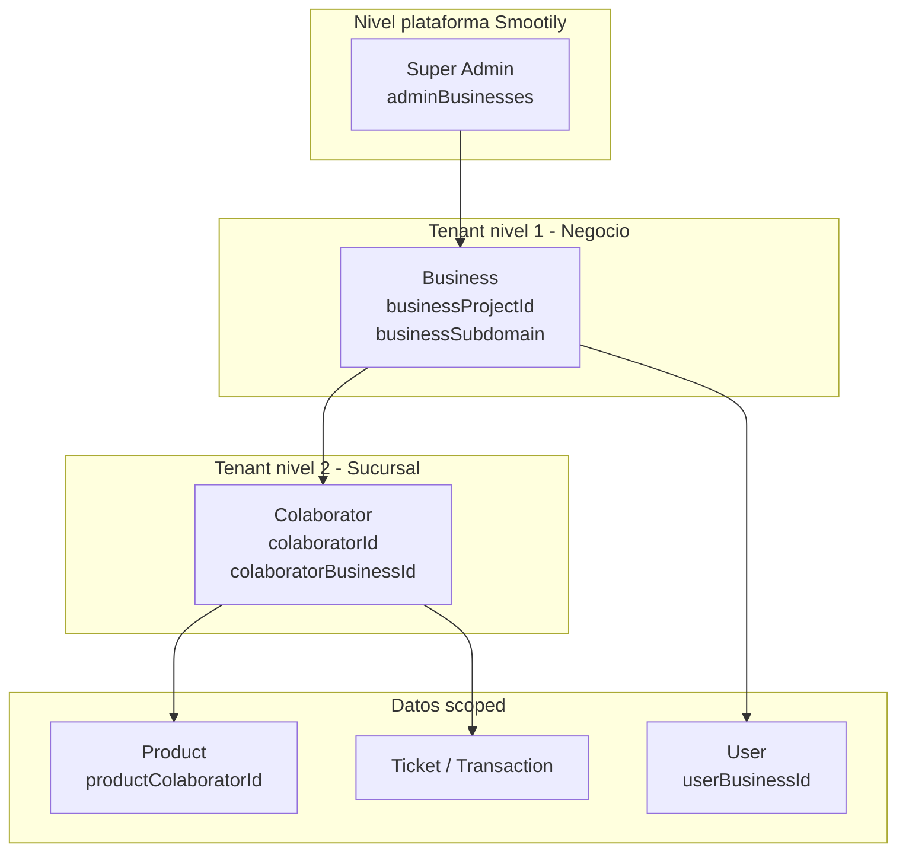
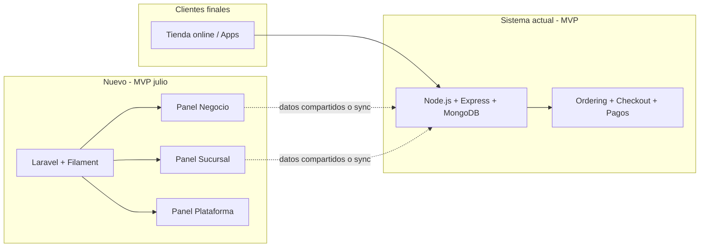
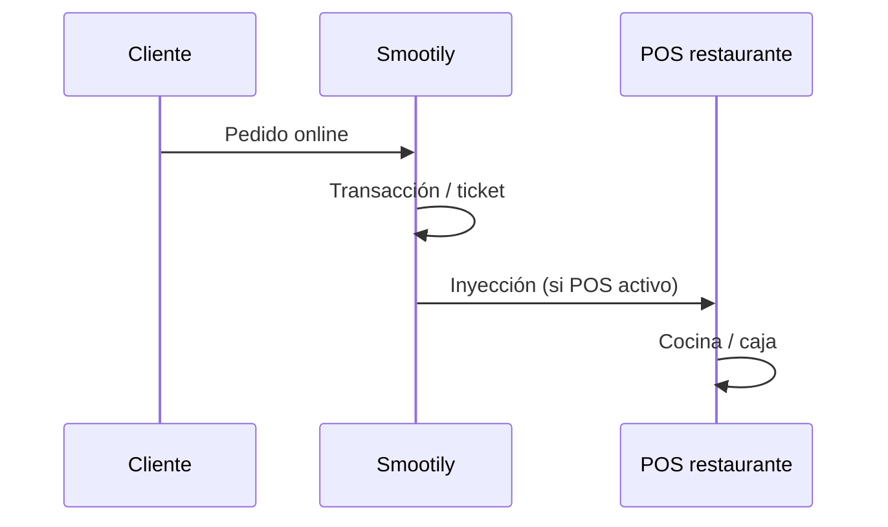

# Smootily (slineweb)

## Auditoría del proyecto y propuesta de modernización del panel administrativo

**Versión:** 1.2  
**Fecha de referencia:** Mayo 2026  
**Fecha objetivo del MVP:** 18 de julio de 2026  
**Cierre de desarrollo (último día hábil):** Viernes 17 de julio de 2026  

> **Nota sobre tiempos:** Todas las estimaciones de esfuerzo y cronograma están expresadas en **días hábiles (lunes a viernes)**. No se cuentan sábados ni domingos.

---

## Tabla de contenidos

1. [Resumen ejecutivo](#1-resumen-ejecutivo)
2. [Qué es el producto hoy](#2-qué-es-el-producto-hoy)
3. [Auditoría del estado actual](#3-auditoría-del-estado-actual)
4. [Inventario técnico del repositorio](#4-inventario-técnico-del-repositorio)
5. [Arquitectura multitenant actual](#5-arquitectura-multitenant-actual)
6. [Módulos funcionales](#6-módulos-funcionales)
7. [Capas de la aplicación (public y rutas)](#7-capas-de-la-aplicación-public-y-rutas)
8. [Diagnóstico: fortalezas y retos](#8-diagnóstico-fortalezas-y-retos)
9. [Propuesta de solución](#9-propuesta-de-solución)
10. [Multi-tenancy con Filament](#10-multi-tenancy-con-filament)
11. [Alcance del MVP](#11-alcance-del-mvp)
12. [Cronograma (solo días hábiles)](#12-cronograma-solo-días-hábiles)
13. [Beneficios para el negocio](#13-beneficios-para-el-negocio)
14. [Riesgos y mitigaciones](#14-riesgos-y-mitigaciones)
15. [Criterios de éxito](#15-criterios-de-éxito)
16. [Próximos pasos](#16-próximos-pasos)
17. [Glosario: ¿Qué es POS?](#17-glosario-qué-es-pos)
18. [Anexo técnico](#18-anexo-técnico)

---

## 1. Resumen ejecutivo

**Smootily** es una plataforma SaaS **multitenant** orientada a restaurantes y negocios con pedidos en línea, múltiples sucursales (“colaboradores”), pagos, envíos, fidelización y operación diaria.

Hoy funciona como una **aplicación monolítica** en **Node.js + Express + EJS + MongoDB**, con más de **70 módulos de negocio**, **~500 pantallas** e integraciones con pasarelas de pago y mensajería de varios países.

### Propuesta

Modernización **por fases** del **panel administrativo** (backoffice), migrándolo a **Laravel + Filament** con **multi-tenancy nativo**, sin interrumpir la tienda online ni las apps que consumen la API actual.

| Pregunta clave | Respuesta |
|----------------|-----------|
| ¿Qué se moderniza primero? | Paneles de administración (dueño, staff, sucursal, super-admin) |
| ¿Qué se mantiene estable en el MVP? | Tienda online (ordering), API móvil, pagos y checkout |
| ¿Cuándo? | MVP operativo: **18 de julio de 2026** (cierre técnico: **17-jul**, viernes) |
| ¿Por qué Filament? | Admin moderno, seguro, multitenant; menor costo de mantenimiento que ~250 vistas EJS custom |
| ¿Unidad de tiempo del plan? | **Días hábiles (L–V)** |

### Conclusión de la auditoría

El producto **no requiere reescritura total**. Requiere **modernizar el backoffice** mientras el motor comercial (ordering + API + pagos) sigue generando valor. La arquitectura multitenant **ya existe en el dominio**; Filament formaliza y refuerza ese aislamiento.

---

## 2. Qué es el producto hoy

Smootily permite que un **negocio** (marca / cadena) opere en digital con:

- **Varias sucursales** (colaboradores), cada una con menú, horarios, delivery/pickup y configuración propia.
- **Tienda online white-label** con temas visuales distintos (estilo Deliveroo, Rappi, etc.).
- **Gestión de pedidos** en tiempo real, repartidores, reservaciones y mesas.
- **Marketing y retención:** cupones, puntos, recompensas, referidos, encuestas, banners.
- **Pagos multi-país** y **envíos** con carriers externos.
- **Roles granulares:** dueño, staff de cadena, operador de sucursal, administrador de plataforma.
- **Integración con POS** (punto de venta / caja del restaurante) vía proveedores como Omnivore.

**Modelo de negocio:** B2B2C — la plataforma se vende a negocios; los negocios atienden a sus clientes finales.

---

## 3. Auditoría del estado actual

### 3.1 Stack tecnológico

| Área | Tecnología | Observación |
|------|------------|-------------|
| Runtime | Node.js **12.19.0** | Fin de vida; riesgo de seguridad |
| Framework web | Express 4.17 | Monolito |
| Vistas | EJS | ~498 plantillas en `public/views` |
| Base de datos | MongoDB Atlas | Mongoose 5.9, `mongodb+srv` |
| Auth | Firebase Admin + JWT | Dueño y usuarios tienda |
| Push | Firebase Cloud Messaging | |
| Email | Nodemailer | 52 plantillas en `public/emails/` |
| PHP / Laravel | **No presente** | `composer.json` solo declara `ext-mbstring` |
| Archivos estáticos | Carpeta `public/` | CSS, JS, imágenes, SASS |

### 3.2 Métricas del repositorio (auditoría mayo 2026)

| Componente | Cantidad |
|------------|----------|
| Archivos totales (aprox.) | ~988 |
| Modelos Mongoose (`api/models/`) | **74** |
| Rutas API (`api/routes/`) | **~68** módulos |
| Pasarelas de pago | **8** |
| Workers en background | **4** |
| Vistas EJS (`public/views/`) | **~498** |
| — Dashboard dueño (`dashboard/es`) | 98 |
| — Dashboard staff (`dashboardStaff/es`) | 112 |
| — Dashboard colaborador (`dashboardColaborators/es`) | 30 |
| — Dashboard admin (`dashboardAdmin/es`) | 6 |
| — Ordering (6 temas) | ~140 |
| Plantillas de email | **52** |
| Scripts JS en `public/js/` | **64** |
| Carriers de envío | **9** |

### 3.3 Integraciones identificadas

**Pagos** (`api/routes/payments/`):

- Stripe, PayPal, Mercado Pago, Transbank, Conekta, dLocal, OpenPay, Mitec

**Envíos** (`api/utils/carriers/`):

- Uber, Rappi, PedidosYa, Lalamove, iVoy, Jelp, Zubut, DostaVista, Mensajeros Urbanos

**Otros:**

- Firebase (auth storage, notificaciones)
- Twilio (SMS)
- WhatsApp
- Google APIs
- Omnivore (POS)
- Nodemailer + `emailKey.json` (no versionado)

### 3.4 Workers en segundo plano

| Worker | Función |
|--------|---------|
| `dailyWorker.js` | Tareas diarias programadas |
| `callsWorker.js` | Llamadas / telefonía |
| `posWorker.js` | Estado y sincronización POS (Omnivore) |
| `scheduledTransactionsWorker.js` | Transacciones programadas |

### 3.5 Variables de entorno relevantes

| Variable | Uso |
|----------|-----|
| `DB_USERNAME`, `DB_PASSWORD`, `DB_URL`, `DB_NAME` | MongoDB Atlas |
| `PORT` | HTTP (default 8080) |
| `NODE_ENV` | HTTPS en producción; manejo de errores |
| `ADMIN_API_KEY` | Rutas de administración |
| `PAYPAL_CLIENT_ID`, `PAYPAL_CLIENT_SECRET` | PayPal |
| `NOTIFICATION_WEB_KEY` | FCM web |
| `OMNIVORE_API_KEY` | Integración POS Omnivore |

**No versionados (seguridad):** Firebase JSON en `config/`, `api/utils/emailKey.json`, `.env`

---

## 4. Inventario técnico del repositorio

### 4.1 Estructura de carpetas

```
slineweb/
├── server.js                 # Entry point, MongoDB, Firebase, HTTPS
├── package.json              # Node 12.19.0, dependencias
├── composer.json             # Solo ext-mbstring (sin Laravel)
├── api/
│   ├── models/               # 74 modelos Mongoose
│   ├── routes/               # Lógica REST + payments/
│   ├── utils/                # email, SMS, carriers, auth, export, POS
│   └── constant.js           # API keys (revisar rotación en prod)
├── routes/
│   ├── api/                  # Montaje de api/routes en Express
│   └── web/                  # dashboards, ordering, landing, auth
├── public/
│   ├── views/                # EJS
│   ├── js/, css/, images/, sass/, emails/
├── config/                   # Firebase (no versionado)
├── dailyWorker.js, callsWorker.js, posWorker.js, scheduledTransactionsWorker.js
└── README.md
```

### 4.2 Punto de entrada (`server.js`)

- Conexión MongoDB Atlas
- Firebase Admin inicializado
- Middleware: HTTPS (prod), cookies, CORS, rate limit, file upload
- Guards de dashboard por cookie (`staff`, `colaborator`)
- ~67 módulos API + rutas web (dashboards, ordering, landing)
- Fallback 404 → `/notFound`

### 4.3 Listado de modelos (74)

`Admin`, `Ad`, `Address`, `AppSettings`, `Audience`, `AuthSettings`, `Business`, `BusinessStats`, `Call`, `Card`, `CartItem`, `Category`, `Colaborator`, `ColaboratorStats`, `Conversation`, `Coupon`, `CouponRedeem`, `DeveloperSettings`, `Device`, `DomainName`, `Driver`, `Email`, `EmailSettings`, `EventLog`, `Faq`, `FaqCategory`, `FeatureSettings`, `GiftCard`, `Guest`, `Hours`, `LinkItem`, `LinkSettings`, `LocationFolder`, `Menu`, `Modifier`, `ModifierGroup`, `Movement`, `Notification`, `NotificationSettings`, `PaymentSettings`, `PhoneCallSettings`, `PointsBalance`, `PosItem`, `PosSettings`, `PosTable`, `Product`, `QrSettings`, `ReferralSettings`, `Reservation`, `Review`, `Reward`, `RewardReedem`, `Section`, `Shipment`, `ShipmentArea`, `ShipmentQuote`, `ShipmentSettings`, `Sms`, `SmsSettings`, `Staff`, `StaffInvite`, `Survey`, `SurveyAnswer`, `SurveyAnswerGroup`, `SurveyQuestion`, `SurveyQuestionAnswer`, `Table`, `Ticket`, `Transaction`, `User`, `Webhook`, `WebSettings`, `WhatsappMessage`, `WhatsappSettings`

### 4.4 Rutas API montadas en `server.js`

`whatsappSettings`, `modifier`, `auth`, `modifierGroup`, `posSettings`, `table`, `card`, `webhook`, `authSettings`, `appSettings`, `developerSettings`, `emailSettings`, `business`, `notifications`, `driver`, `address`, `cartItem`, `webSettings`, `payments`, `shipmentSettings`, `smsSettings`, `phoneCallSettings`, `faqCategory`, `coupon`, `couponRedeem`, `search`, `stats`, `review`, `eventLog`, `transaction`, `product`, `colaborator`, `hours`, `ticket`, `reward`, `locationFolder`, `faq`, `menu`, `domainName`, `category`, `movement`, `section`, `rewardsReedem`, `pointsBalance`, `paymentSettings`, `staff`, `shipmentArea`, `reservation`, `ad`, `shipmentQuote`, `shipment`, `referralSettings`, `user`, `giftCard`, `posItem`, `admin`, `device`, `conversation`, `survey`, `surveyQuestion`, `surveyAnswer`, `surveyAnswerGroup`, `featureSettings`, `guest`, `linkSettings`, `linkItem`, `surveyQuestionAnswer`

### 4.5 Rutas web

| Módulo | Archivo | Función |
|--------|---------|---------|
| Dashboard dueño | `routes/web/dashboard/dashboardNative.js` | ~85 rutas GET → EJS |
| Dashboard staff | `routes/web/dashboardStaff/dashboardNative.js` | ~93 vistas renderizadas |
| Dashboard colaborador | `routes/web/dashboardColaborator/dashboardNative.js` | ~30 pantallas |
| Dashboard admin | `routes/web/dashboardAdmin/dashboardAdmin.js` | 2 rutas (stats, platforms) |
| Ordering | `routes/web/ordering/orderingRouter.js` + `ordering.js` | Tienda online |
| Landing | `routes/web/landing.js` | Marketing corporativo |
| Auth | `routes/web/auth/authNative.js` | Login tienda |
| Pagos | `routes/web/paymentViews.js` | Vistas de pago |
| Email | `routes/web/email.js` | Preview emails |
| Help | `routes/web/help.js` | Ayuda |

---

## 5. Arquitectura multitenant actual

### 5.1 Jerarquía de tenants



### 5.2 Entidades y claves

| Entidad | Identificadores | Rol |
|---------|-----------------|-----|
| `Business` | `businessProjectId` (índice), `businessSubdomain` | Raíz del tenant; dueño = Firebase uid |
| `Colaborator` | `colaboratorId` (string), `colaboratorBusinessId` | Sucursal / tienda |
| `Staff` | `staffBusinessId`, `staffColaborators[]`, permisos numéricos | Backoffice cadena |
| `Admin` | `adminBusinesses[]`, `adminBusinessesPermissions` | Super-admin plataforma |
| `User` | `userBusinessId`, `userId` | Cliente final |
| `Product` | `productColaboratorId`, `productBusinessId` | Catálogo por sucursal |
| `Ticket` | `ticketBusinessId`, `ticketColaboratorId` | Pedidos tipo ticket |
| `Transaction` | `transactionBusinessId`, colaborador vía productos | Pedidos / pagos |

### 5.3 Paneles web y control de acceso

| Prefijo URL | Vistas EJS | Mecanismo de acceso |
|-------------|------------|---------------------|
| `/dashboard/` | 98 | Dueño (`uid === businessProjectId`) |
| `/dashboardStaff/` | 112 | Cookie `staff` |
| `/dashboardColaborators/` | 30 | Cookie `colaborator` |
| `/dashboardAdmin/` | 6 | Super-admin |
| `/store/:storeId` | Ordering | Público / usuario tienda |
| Subdominio | `businessSubdomain` | Resolución de negocio en ordering |

**Middleware en `server.js`:** redirige a `/logInToStore` si falta cookie en rutas de dashboard staff/colaborador.

### 5.4 Sistema de permisos

**Staff — permisos de negocio** (`staffBusinessPermissions`): índices 0–105 documentados en `api/models/Staff.js` (colaboradores, pagos, reviews, cupones, drivers, banners, stats, settings, FAQ, categorías, usuarios, pedidos, staff, reservaciones, envíos, webhooks, reembolsos, mesas, etc.).

**Staff — permisos por sucursal** (`staffColaboratorsPermissions`): matriz de permisos por cada colaborador en `staffColaborators[]`.

**Colaborador — permisos propios:** índices 0–30 (settings, reviews, hours, categories, products, stats, orders, map, reservations, tables, refunds).

**Patrón en API:** validación repetida en cada `api/routes/*.js`:

```text
uid === req.params.businessId
  OR staff.staffBusinessId == businessId && staff.staffBusinessPermissions.includes(N)
  OR staff tiene acceso al colaboratorId con permiso en staffColaboratorsPermissions[i]
```

---

## 6. Módulos funcionales

| Dominio | Modelos / rutas |
|---------|-----------------|
| **Catálogo** | Product, Category, Menu, Modifier, ModifierGroup, Section |
| **Pedidos** | Transaction, Ticket, CartItem, Movement |
| **Clientes** | User, Guest, Address, Card, Device |
| **Equipo** | Staff, StaffInvite, Colaborator, Driver |
| **Marketing** | Coupon, CouponRedeem, Ad, Reward, PointsBalance, ReferralSettings |
| **Operación** | Hours, Table, Reservation, PosTable, PosItem, PosSettings |
| **Logística** | Shipment, ShipmentArea, ShipmentSettings, ShipmentQuote + 9 carriers |
| **Comunicación** | Notification, Sms, WhatsappMessage, Email, Conversation, Call |
| **Contenido** | Faq, FaqCategory, LinkItem, LinkSettings, WebSettings |
| **Calidad** | Review, Survey*, EventLog |
| **Plataforma** | Admin, Business, BusinessStats, DeveloperSettings, AppSettings |
| **Pagos** | PaymentSettings, Transaction + 8 gateways |

### Dashboard dueño — módulos principales (rutas en `dashboardNative.js`)

Stats (general, cupones, pedidos, usuarios, colaboradores, productos, pagos, drivers, reservaciones), webhooks, developer settings, puntos/rewards, envíos, encuestas, tickets, auth settings, referral, shipment settings, reservaciones, secciones, FAQ, QR/SMS/WhatsApp/notificaciones/email/web settings, mapa, banners, delivery range, mesas, menús, productos, categorías, payment/phone settings, ventas (`sold`), carritos abandonados, usuarios, transacciones, cupones, horarios, reviews, drivers, notificaciones, settings generales, zonas de envío, staff, colaboradores.

---

## 7. Capas de la aplicación (public y rutas)

### 7.1 `public/views/` — mapa por área

| Carpeta | Propósito | MVP Filament |
|---------|-----------|--------------|
| `dashboard/` | Admin del negocio (dueño) | **BusinessPanel** |
| `dashboardStaff/` | Operación cadena / multi-sucursal | **StorePanel** + scope |
| `dashboardColaborators/` | Operación una sucursal | **StorePanel** |
| `dashboardAdmin/` | Super-admin plataforma | **PlatformPanel** |
| `ordering/` | Tienda online (6 temas) | **Fuera MVP** — Node |
| `landing/`, `landingSline/` | Marketing | **Fuera MVP** |
| `auth/`, `authCustom/`, `authSline/` | Login / registro | Filament auth (admin) |
| `payments/` | Vistas de pago | **Fuera MVP** |
| `public/emails/` | Notificaciones transaccionales | Mantener Node inicialmente |

### 7.2 Temas de ordering (tienda online)

| Tema | Carpeta |
|------|---------|
| Deliveroo | `themeDeliveroo` |
| Rappi | `themeRappi` |
| Estoril | `themeEstoril` |
| Estoril Dark | `themeEstorilDark` |
| Fooyes | `themeFooyes` |
| Foodbot | `themeFoodbot` |

Selección de tema por configuración en `routes/web/ordering/ordering.js`. Rutas clave: `/store/:storeId`, checkout, cuenta, búsqueda, FAQ, zonas de envío.

### 7.3 Landing corporativa

Rutas en `routes/web/landing.js`: `/`, `/howItWorks`, `/ourServices`, `/pricing`, `/jobs`, `/aboutUs`, `/terms`, help sections, ES/EN.

---

## 8. Diagnóstico: fortalezas y retos

### Fortalezas

- Funcionalidad amplia y probada en producción.
- Multitenancy real en modelo de datos y permisos.
- Ecosistema de integraciones (pagos, carriers, Firebase, correo, WhatsApp/SMS, POS).
- Internacionalización parcial (ES/EN) en landing y ordering.
- White-label por subdominio y temas visuales.

### Retos

| Reto | Impacto |
|------|---------|
| ~346 pantallas EJS solo en dashboards | Cada mejora es lenta; UX desactualizada |
| Node.js 12 (EOL) | Seguridad y compatibilidad |
| Permisos dispersos en decenas de archivos API | Riesgo de fuga entre tenants al escalar |
| Sin framework admin estándar | Frena features comerciales y auditorías |
| Duplicación `api/routes` vs `routes/api` | Mantenimiento confuso |
| Secretos en código (`api/constant.js`) | Riesgo de seguridad — rotar en producción |
| 74 modelos / integraciones complejas | Migración total inviable en un solo hito |

---

## 9. Propuesta de solución

### 9.1 Enfoque: Strangler Fig (evolución, no revolución)



| Fase | Alcance |
|------|---------|
| **MVP (→ 17-jul-2026)** | Admin Filament; ordering y API en Node |
| **Fase 2** | API, reportes, más módulos admin |
| **Fase 3 (opcional)** | Ordering o unificación total según ROI |

### 9.2 Stack objetivo (admin)

| Componente | Versión orientativa |
|------------|---------------------|
| PHP | 8.2+ |
| Laravel | 11.x |
| Filament | 3.x / 5.x |
| BD MVP | PostgreSQL recomendado |
| Auth admin | Laravel + migración desde Firebase (por definir) |

Documentación: [filamentphp.com/docs](https://filamentphp.com/docs)

### 9.3 Estrategia de datos MVP

| Opción | Pros | Contras |
|--------|------|---------|
| A. Sync Mongo → PostgreSQL | Node sin cambios | Complejidad sync |
| B. Laravel lee Mongo | Un solo source | Filament menos idiomático |
| **C. Migrar P0 a PG; Node para ordering/pagos** | **Filament óptimo** | Esfuerzo migración |

**Recomendación:** Opción **C** para entidades P0; preservar IDs legacy (`businessProjectId`, `colaboratorId`).

---

## 10. Multi-tenancy con Filament

### 10.1 Principio

Filament soporta **un modelo Tenant por panel**. Smootily tiene **dos niveles** → **dos paneles con dos tenants**.

| Panel Filament | Tenant | Usuarios | Reemplaza |
|----------------|--------|----------|-----------|
| **BusinessPanel** | `Business` | Dueño, staff con permisos globales | `/dashboard/*` |
| **StorePanel** | `Colaborator` | Staff de sucursal, operador colaborador | `/dashboardStaff/*`, `/dashboardColaborators/*` |
| **PlatformPanel** | Sin tenant / multi-negocio | Super-admin | `/dashboardAdmin/*` |

### 10.2 URLs propuestas

```text
https://admin.ejemplo.com/business/{business_slug}/...
https://admin.ejemplo.com/store/{colaborator_id}/...
```

Slug de negocio: `businessSubdomain` o `businessProjectId`.  
Store: mantener `colaboratorId` string (compatible con `/store/:storeId`).

### 10.3 Implementación conceptual

```php
// BusinessPanel
Panel::make()
    ->id('business')
    ->tenant(Business::class);

// StorePanel
Panel::make()
    ->id('store')
    ->tenant(Colaborator::class);
```

- Usuario Laravel unificado: `HasTenants`, `canAccessTenant()`
- Modelos: trait `BelongsToTenant`
- Staff en StorePanel: `getTenants()` → solo `staffColaborators`
- Policies + permisos P0 mapeados desde índices numéricos actuales

### 10.4 Scoping de datos

| Modelo | business_id | colaborator_id | Panel |
|--------|-------------|----------------|-------|
| Product | sí | sí (tenant Store) | Store |
| Ticket / Transaction | sí | sí | Store |
| Coupon, Staff, WebSettings | sí | — | Business |
| Colaborator | sí | — | Business (CRUD sucursales) |

### 10.5 Anti-patrones a evitar

- Un solo panel con tenant `Business` sin filtrar colaborador → staff vería todas las sucursales.
- Duplicar scope manual sin `BelongsToTenant` → riesgo de fuga de datos.
- Mezclar `ObjectId` Mongo y bigint SQL sin tabla de mapeo legacy.

---

## 11. Alcance del MVP

### 11.1 Incluido

| Módulo | Capacidades |
|--------|-------------|
| Identidad y acceso | Login, roles, selector negocio/sucursal, permisos P0 |
| Sucursales | CRUD colaboradores, configuración básica |
| Catálogo | Categorías, productos, menús, modificadores (por sucursal) |
| Pedidos | Listado, detalle, estados operativos |
| Usuarios y equipo | Clientes (lectura), staff, invitaciones |
| Cupones | CRUD básico a nivel negocio |
| Operación sucursal | Horarios, mesas, reservaciones (prioridad acordada) |
| Dashboard | Widgets: pedidos del día, ventas recientes |
| Configuración | Web, notificaciones, email (formularios esenciales) |

### 11.2 Resources Filament P0 (orden de build)

1. Business  
2. Colaborator  
3. Category, Product, Menu, ModifierGroup, Modifier  
4. Ticket / Transaction  
5. User, Staff  
6. Coupon  
7. Table, Hours, Reservation  
8. Settings pages  

### 11.3 Fuera del MVP

- Tienda online (6 temas, ~140 vistas, checkout)
- Landing corporativa
- Stats avanzados (mapas, 20+ dashboards analíticos)
- Integraciones completas: todos los carriers, webhooks, encuestas, rewards, **POS completo**
- Migración de las 8 pasarelas al stack Laravel
- Apagado total de Node
- Los 74 modelos migrados

---

## 12. Cronograma (solo días hábiles)

**Inicio:** Martes 19 de mayo de 2026  
**Meta comercial:** Sábado 18 de julio de 2026  
**Último día de trabajo:** Viernes **17 de julio de 2026**  
**Ventana hábil disponible (19 may → 17 jul):** ~**44 días hábiles**  
**Esfuerzo estimado MVP:** **40–46 días hábiles**  
**Duración:** **9 semanas laborales**

| Fase | Días hábiles (L–V) | Semanas laborales | Entregable |
|------|-------------------|-------------------|------------|
| Alineación | 4 | 1 | Alcance, piloto, permisos P0 |
| Fundación Laravel + Filament | 7 | 1–2 | Login, 2 paneles, staging |
| Datos y tenancy | 9 | 2–3 | Migración P0, aislamiento tenants |
| Catálogo | 9 | 4–5 | Menú y productos |
| Pedidos y usuarios | 7 | 6–7 | Operación pedidos y equipo |
| Configuración y pulido | 6 | 8 | Settings, proxy `/admin` |
| QA y go-live piloto | 4 | 9 | Pruebas multitenant, piloto |
| **Total** | **46** | **9** | **Go-live vie 17-jul** |

### Hitos

| Fecha | Hito |
|-------|------|
| Vie 22 may 2026 | Alcance y arquitectura acordados |
| Vie 5 jun 2026 | Demo: login + tenancy |
| Vie 19 jun 2026 | Demo: catálogo por sucursal |
| Vie 3 jul 2026 | Demo: flujo de pedido completo |
| Vie 10 jul 2026 | Feature freeze MVP |
| **Vie 17 jul 2026** | **Go-live piloto** |
| Sáb 18 jul 2026 | Fecha objetivo comercial (sin jornada dev) |

### Calendario por semana laboral

| Sem. | Días hábiles | Calendario (L–V) | Foco |
|------|-------------|------------------|------|
| 1 | 1–5 | 19–23 may | Alineación + fundación |
| 2 | 6–10 | 26–30 may | Paneles, auth, tenancy |
| 3 | 11–15 | 2–6 jun | Migración datos |
| 4 | 16–20 | 9–13 jun | Catálogo (inicio) |
| 5 | 21–25 | 16–20 jun | Catálogo (cierre) |
| 6 | 26–30 | 23–27 jun | Pedidos + usuarios |
| 7 | 31–35 | 30 jun – 4 jul | Pedidos + settings |
| 8 | 36–40 | 7–11 jul | Config, pulido |
| 9 | 41–45 | 14–17 jul | QA + go-live |

> Validar festivos locales (p. ej. 1º de julio) que reduzcan días hábiles.

**Margen:** Si el esfuerzo llega a 46 días y solo hay 44 disponibles, recortar FAQ/reviews del MVP o mover go-live al **vie 24-jul** (+5 días hábiles).

---

## 13. Beneficios para el negocio

| Beneficio | Descripción |
|-----------|-------------|
| Time-to-market admin | Nuevas pantallas en días vs semanas |
| UX moderna | UI consistente, responsive |
| Seguridad multitenant | Aislamiento por framework |
| Escalabilidad comercial | Más negocios sin multiplicar deuda EJS |
| Stack estándar | Laravel/Filament, documentación y comunidad |
| Riesgo controlado | Ordering y pagos intactos en MVP |
| Base para monetización | Planes por sucursal, límites, branding (fases futuras) |

---

## 14. Riesgos y mitigaciones

| Riesgo | Mitigación |
|--------|------------|
| Alcance creep | MVP firmado; backlog Fase 2 |
| Migración MongoDB → SQL | Por lotes; IDs legacy; negocio piloto |
| Permisos no 100 % equivalentes | Matriz ~15 permisos P0 |
| Dos sistemas en paralelo | Proxy, runbook, rollback |
| Ventana 44 vs 46 días hábiles | Recorte P2 o fecha 24-jul |
| Festivos | Calendario acordado al inicio |

---

## 15. Criterios de éxito

### Negocio

1. Negocio piloto gestiona menú y pedidos desde Filament.  
2. Staff no ve sucursales no autorizadas.  
3. Tienda online y apps sin cambios para el consumidor final.  
4. Capacitación operativa < 2 horas para tareas diarias.

### QA multitenant (pre go-live)

- [ ] Business A no accede a tenant de Business B (403)  
- [ ] Staff solo ve colaboradores en `staffColaborators`  
- [ ] Crear producto asigna `colaborator_id` del tenant activo  
- [ ] Colaborador no accede a Panel Negocio sin permiso  
- [ ] Pedidos filtrados por business + colaborador  
- [ ] Ordering `/store/:storeId` sin regresión  
- [ ] API móvil con `:businessId` sin regresión  

---

## 16. Próximos pasos

1. Aprobar alcance MVP y fecha (17-jul cierre / 18-jul comercial).  
2. Designar negocio piloto (1 marca, 1–3 sucursales).  
3. Workshop permisos P0 y flujos diarios (~2 h).  
4. Kick-off técnico: repo Laravel, ambientes, estrategia de datos (opción C).  
5. Demos al cierre de cada semana laboral hasta go-live.

---

## 17. Glosario: ¿Qué es POS?

**POS** = **Point of Sale** (punto de venta / caja del restaurante).

Sistema que usa el local en mostrador o cocina: pedidos en sala, cobro, comandas, mesas. **No es el panel web de Smootily**, sino la **integración con la caja que ya usa el restaurante**.

### En Smootily

| Componente                      | Función                                                      |
| ------------------------------- | ------------------------------------------------------------ |
| `PosSettings`                   | Configuración por sucursal (activo, proveedor, IDs externos) |
| `PosItem`                       | Productos mapeados Smootily ↔ POS                            |
| `PosTable`                      | Mesas sincronizadas                                          |
| `posWorker.js`                  | Monitoreo de estado (Omnivore)                               |
| `transactionPosInjectionStatus` | Estado de envío del pedido online al POS                     |

### Proveedores en `PosSettings`

| Código | Sistema |
|--------|---------|
| 0 | Omnivore (más implementado; API + `OMNIVORE_API_KEY`) |
| 1 | Wansoft |
| 2 | Deliverect |
| 3 | Hubster |

### Flujo



**MVP:** administración de pedidos en Filament; **inyección POS sigue en Node** hasta Fase 2.

---

## 18. Anexo técnico

### 18.1 Deuda técnica priorizada

| Prioridad | Item |
|-----------|------|
| P0 | Node 12 → LTS en legacy (paralelo a Filament) |
| P0 | Centralizar autorización multitenant |
| P1 | Rotar secretos en `api/constant.js` |
| P1 | Unificar `api/routes` vs `routes/api` |
| P2 | Tests automatizados |
| P2 | Docker / CI Laravel + Node |

### 18.2 Estimación de esfuerzo por fase (días hábiles)

| Fase                         | Días hábiles (L–V) |
| ---------------------------- | ------------------ |
| Diseño + tenancy             | 4                  |
| Laravel + 2 paneles Filament | 7                  |
| Migración datos P0           | 9                  |
| Catálogo                     | 9                  |
| Pedidos + usuarios           | 7                  |
| Settings + integración       | 6                  |
| QA + go-live                 | 4                  |
| **Total**                    | **46**             |

### 18.3 Referencias

- [Filament Documentation](https://filamentphp.com/docs)  
- [Filament Resources](https://filamentphp.com/docs/5.x/resources/overview)  
- [Filament LLM index](https://filamentphp.com/docs/llms.txt)  
- Repositorio: [slineweb en GitLab](https://vcs.789.com.mx/ricardo.nava/slineweb)  
- README interno: `/README.md`

---

*Documento generado a partir de auditoría del repositorio slineweb (Smootily). Los plazos usan días hábiles (L–V) y asumen alcance MVP acotado y negocio piloto designado.*
