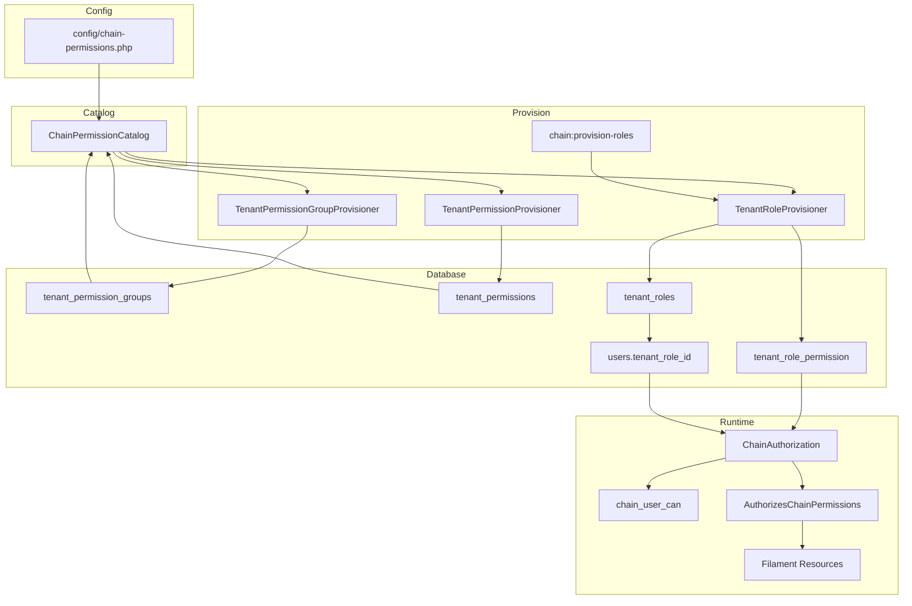
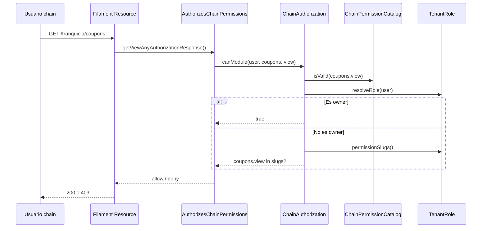

# RBAC del portal cadena (`/franquicia`)

Documentación de la arquitectura de permisos, roles y autorización del panel Filament
**Franquicia**. Es un sistema **tenant-scoped** (por cadena): cada `Chain` tiene su
propio catálogo de permisos, grupos y roles. No usa Spatie Permission ni policies
de Laravel por módulo; la autorización se resuelve en `ChainAuthorization` y se
expone a Filament mediante el trait `AuthorizesChainPermissions`.

---

## Resumen ejecutivo

| Concepto | Descripción |
|----------|-------------|
| **Tenant** | Cadena (`chains.id` = `users.tenant_id`) |
| **Permiso** | Slug `{modulo}.{accion}` (ej. `coupons.edit`) |
| **Grupo** | Agrupación visual (Operación, Seguridad, etc.) |
| **Rol** | Conjunto de permisos asignado a usuarios chain |
| **Módulo** | Recurso Filament o área funcional (`coupons`, `roles`, …) |
| **Acción** | `view`, `create`, `edit`, `delete` (+ custom: `export`, `approve`) |

El rol **owner** (`slug = owner`, `is_system = true`) tiene **bypass total**: no
necesita filas en `tenant_role_permission`.

---

## Diagrama de arquitectura



---

## Flujo de autorización (request)



**Importante (Filament v5):** los botones de crear, editar y eliminar usan
`getCreateAuthorizationResponse()`, `getEditAuthorizationResponse()` y
`getDeleteAuthorizationResponse()`, no solo `canCreate()` / `canEdit()`. El trait
sobrescribe ambos para que la UI y el mount de páginas coincidan.

---

## Configuración: `config/chain-permissions.php`

Fuente de verdad de **módulos del sistema** y **grupos del sistema**.

### Grupos (`groups`)

| Slug | Etiqueta |
|------|----------|
| `operacion` | Operación |
| `menu` | Menú |
| `marketing` | Marketing |
| `estadisticas` | Estadísticas |
| `seguridad` | Seguridad |
| `administracion` | Administración |

Se sincronizan a `tenant_permission_groups` con `is_system = true`.

### Acciones

| Tipo | Clave config | Acciones |
|------|--------------|----------|
| CRUD | `action_labels` | `view`, `create`, `edit`, `delete` |
| Personalizadas | `custom_actions` | `export`, `approve` |

Las acciones CRUD generan permisos de sistema al provisionar. Las custom sirven
para **crear permisos manualmente** en `/franquicia/permissions/create` (slug
`{modulo}.{accion}`).

### Módulos (`modules`)

Cada entrada define:

```php
'coupons' => [
    'label' => 'Cupones',
    'group' => 'marketing',           // group_key en BD
    'actions' => ['view', 'create', 'edit', 'delete'],
],
```

Solo las acciones listadas existen como permisos de sistema para ese módulo.
Ejemplos especiales:

- `orders`, `abandoned_carts`, `statistics`, `delivery_heatmap` → solo `view`
- `branding` → `view`, `edit` (sin create/delete en config)
- Módulos nuevos relevantes: `delivery_heatmap`, `surveys`, `setting_groups`, `setting_definitions`, `general_settings`
- `customers` → label **"Usuarios registrados"**, grupo `marketing`

### Permisos generados

`ChainPermissionCatalog::configDefinitions()` expande módulos × acciones:

```
coupons + view   → coupons.view   → "Ver Cupones"
coupons + edit   → coupons.edit   → "Editar Cupones"
```

---

## Base de datos

### `tenant_permission_groups`

| Columna | Uso |
|---------|-----|
| `tenant_id` | FK → `chains` |
| `slug` | Identificador (`operacion`, `seguridad`, custom) |
| `name` | Nombre visible |
| `is_system` | `true` = viene del config |

### `tenant_permissions`

| Columna | Uso |
|---------|-----|
| `tenant_id` | FK → `chains` |
| `slug` | Identificador único (`coupons.edit`) |
| `name` | Nombre visible |
| `group_key` | FK lógica → `tenant_permission_groups.slug` |
| `is_system` | `true` = sincronizado desde config |

### `tenant_roles`

| Columna | Uso |
|---------|-----|
| `tenant_id` | FK → `chains` |
| `slug` | `owner`, `manager`, `admin` o custom |
| `name` | Nombre visible |
| `is_system` | Roles del sistema no se eliminan |

### `tenant_role_permission`

Pivot sin modelo Eloquent. Clave compuesta `(tenant_role_id, permission)` donde
`permission` es el **slug** (string), no FK a `tenant_permissions.id`.

### `users.tenant_role_id`

FK al rol activo del usuario chain. Se mantiene alineado con `users.role` (slug
legacy) para roles del sistema vía `SyncsChainUserTenantRole`.

---

## Clases principales

### `App\Support\ChainPermissionCatalog`

Catálogo central. Lee config + BD del tenant.

| Método | Propósito |
|--------|-----------|
| `configDefinitions()` | Permisos de sistema desde config |
| `definitions($tenantId)` | Todos los permisos del tenant (sistema + custom) |
| `permissionMatrix($tenantId)` | Matriz para UI de roles (grupos → módulos → acciones) |
| `groups($tenantId)` | Grupos disponibles (sistema + custom) |
| `all($tenantId)` | Lista de slugs |
| `isValid($slug, $tenantId)` | ¿Existe el permiso en el catálogo? |
| `buildCustomPermissionSlug($module, $action)` | Genera slug al crear permiso custom |
| `normalizePermissions($slugs)` | Convierte legacy `*.manage` → `*.create` + `*.edit` |
| `expandPermissions($slugs)` | Igual para evaluación en runtime |
| `permissionsForModules($modules)` | Todos los slugs de unos módulos |
| `allExceptModules($modules)` | Todos menos ciertos módulos |

**Matriz de roles:** agrupa por `group_key`, filas por módulo, columnas por acción
CRUD, columna **Todos** por módulo, checkbox **Seleccionar todo** por grupo y global.

### `App\Services\ChainAuthorization`

Motor de autorización en runtime.

```php
// Permiso exacto
$auth->can($user, 'coupons.edit');

// Por módulo + acción (usa en Filament)
$auth->canModule($user, 'coupons', 'edit');

// Helper global
chain_user_can('coupons.edit');
```

**Reglas:**

1. Solo usuarios `UserType::Chain`.
2. Resuelve rol por `tenant_role_id` o fallback `users.role` → `tenant_roles.slug`.
3. **Owner** → siempre `true` (antes de validar si el slug existe).
4. Otros roles → el slug debe existir en catálogo y estar en `tenant_role_permission`.
5. **Legacy:** `canModule` acepta `create`/`edit`/`delete` si existe `{modulo}.manage`.

Caché en memoria por `tenant_role_id` durante el request.

### `App\Filament\Franquicia\Concerns\AuthorizesChainPermissions`

Trait para recursos Filament del panel Franquicia.

**Obligatorio:** implementar `chainPermissionModule(): ?string` (ej. `'coupons'`).

| Método Filament | Acción chain |
|-----------------|--------------|
| `canViewAny` / `canView` | `view` |
| `canCreate` | `create` |
| `canEdit` | `edit` |
| `canDelete` / `canDeleteAny` | `delete` |

**Helpers UI:**

| Método | Uso |
|--------|-----|
| `editableToggleColumn($name, $label)` | `ToggleColumn` solo editable con `edit` |
| `readOnlyFormToggle($name, $label)` | `Toggle` en formulario deshabilitado sin `edit` |
| `chainCanEdit()` | Atajo para lógica custom |

**Recursos que usan el trait (módulos):**

| Resource / Page | `chainPermissionModule()` |
|-----------------|---------------------------|
| `BranchResource` | `branches` |
| `OrderResource` | `orders` |
| `DriverResource` | `drivers` |
| `ShipmentResource` | `shipments` |
| `DeliveryHeatmapPage` / `DeliveryHeatmapBranchPage` | `delivery_heatmap` (via `CanViewDeliveryHeatmap` → `delivery_heatmap.view`) |
| `CategoryResource` | `categories` |
| `ProductResource` | `products` |
| `ModifierGroupResource` | `modifier_groups` |
| `BannerResource` | `banners` |
| `CouponResource` | `coupons` |
| `SurveyResource` | `surveys` |
| `CustomerResource` | `customers` |
| `AbandonedCartResource` | `abandoned_carts` |
| `BrandingResource` | `branding` |
| `GeneralSettingsResource` | `general_settings` |
| `ChainSettingGroupResource` | `setting_groups` |
| `ChainSettingDefinitionResource` | `setting_definitions` |
| `ChainDocumentResource` | `documents` |
| `PickerIntegrationResource` | `picker` |
| `ChainUserResource` | `users` |
| `TenantRoleResource` | `roles` |
| `TenantPermissionResource` | `permissions` |
| `TenantPermissionGroupResource` | `permission_groups` |

**Sin módulo RBAC estándar** (no usan `AuthorizesChainPermissions` / `chainPermissionModule()`):

| Resource | Autorización |
|----------|--------------|
| `BranchReservationResource` | `CanManageFranquiciaReservations` (roles chain Owner/Manager/Admin + módulo reservaciones habilitado) |
| `PaymentGatewayResource` | Acceso panel franquicia + edición limitada al tenant (`chain_id`) |

Algunos recursos **sobrescriben** `canCreate` / `canEdit` / `get*AuthorizationResponse`
por reglas de negocio (solo lectura, tenant propio, etc.). Siempre deben alinear
`can*` con `get*AuthorizationResponse` para no mostrar botones que den 403.

### Provisionadores

| Clase | Responsabilidad |
|-------|-----------------|
| `TenantPermissionGroupProvisioner` | Crea/actualiza grupos desde `config groups` |
| `TenantPermissionProvisioner` | Crea/actualiza permisos sistema; borra obsoletos |
| `TenantRoleProvisioner` | Grupos + permisos + roles sistema + `tenant_role_id` en users |

**Orden al provisionar una cadena:**

1. Grupos de permisos  
2. Permisos de sistema  
3. Roles `owner`, `manager`, `admin`  
4. Permisos por defecto en `manager` y `admin`  
5. Asignación `users.tenant_role_id` según `users.role`

**Comando:**

```bash
vendor/bin/sail artisan chain:provision-roles
```

Ejecutar tras cambiar `chain-permissions.php` o migraciones de catálogo.

### Modelos

| Modelo | Notas |
|--------|-------|
| `TenantRole` | `syncPermissions()`, `permissionSlugs()`, `isOwner()` |
| `TenantPermission` | `groupLabel()` vía catálogo |
| `TenantPermissionGroup` | `permissions()` por `group_key` |

---

## UI de administración (menú Seguridad)

| Pantalla | Ruta | Módulo permiso |
|----------|------|----------------|
| Grupos de permisos | `/franquicia/permission-groups` | `permission_groups` |
| Permisos | `/franquicia/permissions` | `permissions` |
| Roles | `/franquicia/roles` | `roles` |
| Usuarios del portal | `/franquicia/users` | `users` |

### Crear permiso custom

Formulario en `/franquicia/permissions/create`:

1. **Módulo** (sistema o custom)  
2. **Acción** (CRUD o custom)  
3. Slug generado: `{modulo}.{accion}` (ej. `abandoned_carts.create`)  
4. **Grupo** y nombre  

Los permisos custom con patrón `{modulo}.{accion}` válido se integran en la matriz
de roles si el módulo existe en config.

### Editar rol

`RolePermissionsFormBuilder` + `SyncsTenantRolePermissions`:

- Campo oculto `permissions` (array de slugs)  
- Buscador de módulos  
- Secciones por grupo con matriz CRUD  
- Selectores: global, por grupo, por módulo (columna **Todos**)  
- Rol **owner**: sección permisos oculta (bypass)

---

## Roles del sistema

| Slug | Nombre | Permisos (`TenantRoleProvisioner::defaultPermissionsFor`) |
|------|--------|----------|
| `owner` | Dueño de cadena | Todos (bypass, sin filas en pivot) |
| `manager` | Gerente | `allExceptModules([branding, setting_groups, setting_definitions, general_settings, documents, picker, permission_groups, permissions, roles])` |
| `admin` | Administrador de cadena | `permissionsForModules([branches, orders, drivers, shipments, delivery_heatmap, categories, products, modifier_groups, banners, coupons, surveys, abandoned_carts, statistics, users, branding, setting_groups, setting_definitions, general_settings, documents, picker])` |

**Nota admin:** el rol sistema `admin` **no** incluye `customers` ni módulos de seguridad (`roles`, `permissions`, `permission_groups`).

Los roles custom (`is_system = false`) se crean en `/franquicia/roles/create`.

**Restricciones de borrado:**

- Roles/permisos/grupos `is_system` → no eliminables  
- Rol con usuarios asignados → no eliminable  
- Permiso asignado a roles → no eliminable  
- Grupo con permisos → no eliminable  

---

## Mapeo Filament ↔ permisos

| Acción usuario | Permiso requerido | Efecto si falta |
|----------------|-------------------|-----------------|
| Ver menú / listado | `{modulo}.view` | 403 en ruta |
| Botón Nuevo | `{modulo}.create` | Botón oculto |
| Editar registro | `{modulo}.edit` | Botón oculto / 403 en `/edit` |
| Eliminar | `{modulo}.delete` | Botón oculto |
| Toggle inline (`ToggleColumn`) | `{modulo}.edit` | Toggle deshabilitado |

**Permisos custom** no abren recursos Filament automáticamente. Usar en código:

```php
if (chain_user_can('inventario.export')) {
    // exportar...
}
```

---

## Legacy: permisos `*.manage`

Migración `2026_07_01_130000_migrate_manage_permissions_to_crud.php` y helpers
`normalizePermissions` / `expandPermissions` convierten:

```
coupons.manage → coupons.create + coupons.edit
```

`ChainAuthorization::canModule` también acepta `create`/`edit`/`delete` si existe
`{modulo}.manage` (compatibilidad).

---

## Cómo extender el sistema

### Añadir un módulo Filament nuevo

1. Registrar en `config/chain-permissions.php` bajo `modules` con `group` y `actions`.  
2. En el Resource: `use AuthorizesChainPermissions` + `chainPermissionModule()`.  
3. Ejecutar `chain:provision-roles`.  
4. Asignar permisos a roles en Seguridad → Roles.  

### Añadir permiso custom (regla de negocio)

1. Seguridad → Permisos → Nuevo (módulo + acción).  
2. Asignar al rol correspondiente.  
3. En código: `chain_user_can('mi_modulo.export')`.  

### Toggle editable en tabla

```php
// En *Table.php
CouponResource::editableToggleColumn('is_active', 'Activo'),
```

### Comprobar permiso en servicio / controlador

```php
use function chain_user_can;

if (! chain_user_can('orders.view')) {
    abort(403);
}
```

O inyectar `ChainAuthorization`:

```php
app(ChainAuthorization::class)->canModule($user, 'orders', 'view');
```

---

## Helpers y tenant

```php
current_tenant();     // Chain activa (middleware / usuario)
current_tenant_id();  // int|null
chain_user_can('slug'); // bool
```

`CurrentTenant` se establece en el middleware del panel Franquicia (`ResolveTenant`).

---

## Tests

| Archivo | Cubre |
|---------|-------|
| `ChainPermissionCatalogTest` | Config, matriz, slugs custom |
| `FranquiciaRolesTest` | Roles, matriz, select-all |
| `FranquiciaPermissionsTest` | CRUD permisos, catálogo |
| `FranquiciaPermissionGroupsTest` | Grupos |
| `FranquiciaAuthorizationTest` | Recursos, botones ocultos, toggles |

Ejecutar:

```bash
vendor/bin/pest tests/Feature/FranquiciaAuthorizationTest.php \
  tests/Feature/FranquiciaRolesTest.php \
  tests/Feature/FranquiciaPermissionsTest.php \
  tests/Feature/FranquiciaPermissionGroupsTest.php \
  tests/Feature/ChainPermissionCatalogTest.php
```

---

## Archivos de referencia (mapa rápido)

```
config/chain-permissions.php          # Módulos, grupos y acciones del sistema

app/Support/ChainPermissionCatalog.php
app/Services/ChainAuthorization.php
app/Services/TenantRoleProvisioner.php
app/Services/TenantPermissionProvisioner.php
app/Services/TenantPermissionGroupProvisioner.php

app/Models/TenantRole.php
app/Models/TenantPermission.php
app/Models/TenantPermissionGroup.php

app/Filament/Franquicia/Concerns/
  AuthorizesChainPermissions.php      # Trait recursos Filament
  SyncsTenantRolePermissions.php        # Guardar permisos en roles
  SyncsChainUserTenantRole.php          # users.tenant_role_id ↔ role slug

app/Filament/Franquicia/Resources/Roles/Schemas/
  RolePermissionsFormBuilder.php        # Matriz UI de permisos

app/Filament/Franquicia/Resources/Permissions/Schemas/
  TenantPermissionForm.php              # Alta permiso custom

app/Console/Commands/ProvisionChainRoles.php
app/Support/helpers.php                 # chain_user_can(), current_tenant()

database/migrations/2026_07_01_*        # Tablas RBAC
```

---

## Preguntas frecuentes

**¿Por qué owner ve todo aunque el permiso no exista en config?**  
`ChainAuthorization::can()` devuelve `true` para owner antes de validar el slug.

**¿Por qué tengo permiso en rol pero el botón no aparece?**  
Verifica que el Resource use `AuthorizesChainPermissions` y que
`get*AuthorizationResponse()` no esté sobrescrito de forma inconsistente.

**¿Los permisos custom abren un menú nuevo?**  
No. Solo controlan lógica que tú protejas con `chain_user_can()`.

**¿Cuándo corro `chain:provision-roles`?**  
Después de deploy con cambios en `chain-permissions.php` o migraciones de catálogo.

**¿`users.role` sigue usándose?**  
Sí, como slug legacy (`owner`, `manager`, `admin`). La fuente preferida es
`tenant_role_id`; se sincronizan al crear/editar usuarios y al provisionar.
