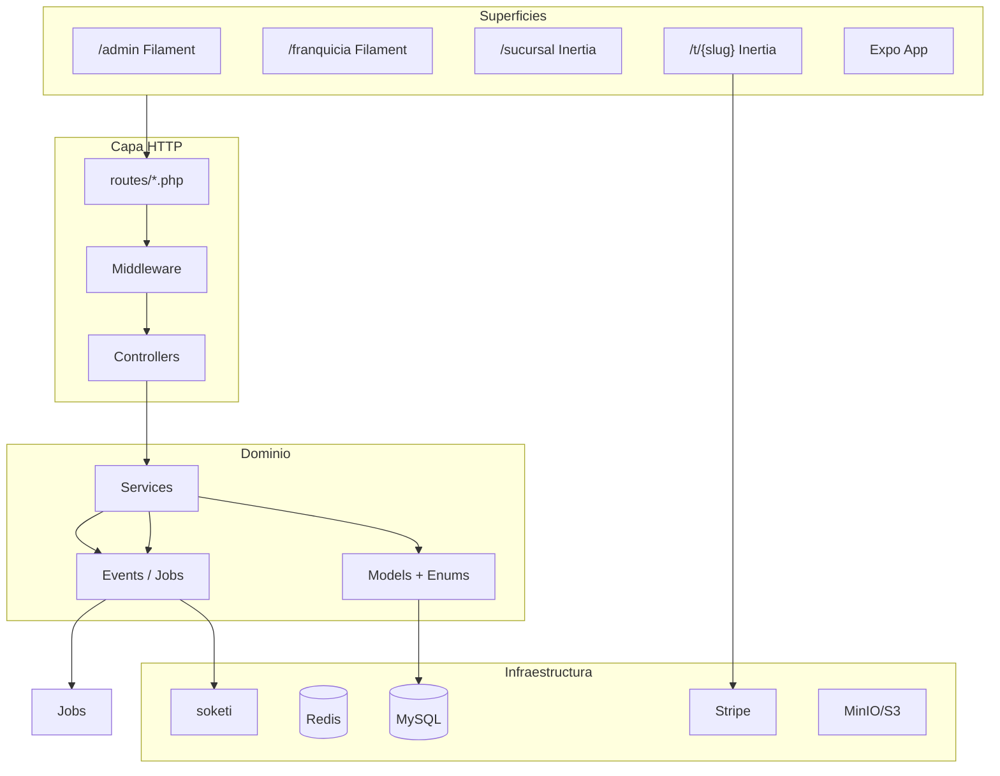

# Arquitectura — Visión general

## Qué es Sline

Sline es un SaaS multi-tenant de delivery white-label. Una sola base de datos MySQL alberga múltiples cadenas (`chains`), cada una con sucursales, menú, pedidos, repartidores y clientes propios.

## Stack tecnológico

| Capa | Tecnología | Versión |
|---|---|---|
| Backend | PHP, Laravel | 8.3+, 13 |
| Admin UI | Filament (Livewire) | v5 |
| PWAs | Inertia + React + Tailwind | v3, 19, 4 |
| Base de datos | MySQL | 8.4 |
| API móvil | Laravel Sanctum | v4 |
| Auth web | Laravel Fortify (2FA, passkeys) | v1 |
| Realtime | soketi (protocolo Pusher) + Laravel Echo | — |
| Pagos | Stripe (+ FakeGateway dev) | — |
| Push | Web Push (VAPID) + Expo Push | — |
| Tests | Pest | v4 |
| Dev local | Laravel Sail (Docker) | — |
| Deploy | Railway (Nixpacks) | — |

## Diagrama de capas



## Principios arquitectónicos

### 1. Lógica de negocio en Services

No hay capa Repository ni DTOs. La lógica vive en `app/Services/`. Los controladores y recursos Filament delegan en servicios.

```
Controller / Filament Page → Service → Model → DB
```

Ejemplos clave:
- `PlaceOrder` — checkout del cliente
- `SubscriptionBillingService` — facturación SaaS
- `BranchProductPresentation` — producto efectivo por sucursal
- `CreateShipment` — envíos de terceros

### 2. Un solo modelo User para todos los actores

Todos los tipos de usuario (`admin`, `chain`, `branch`, `driver`, `customer`) comparten la tabla `users` con el enum `UserType`. Los roles específicos usan enums separados (`AdminRole`, `ChainRole`, `BranchRole`).

### 3. Multi-tenancy por columna

Trait `BelongsToTenant` + global scope `TenantScope` filtran automáticamente por `tenant_id`. Ver [Multi-tenancy](./multi-tenancy.md).

### 4. Sin Policies de Laravel

La autorización es imperativa:
- Middleware (`ValidateUser`, `ResolveBranch`, `EnsureChainIsOperational`)
- `User::canAccessPanel()` para Filament
- Scopes Eloquent en recursos Filament
- Callbacks en `routes/channels.php` para broadcasting

### 5. Dos stacks de UI

| Stack | Cuándo se usa |
|---|---|
| **Filament** | Admin interno y portal de cadena (CRUD, dashboards, estadísticas) |
| **Inertia + React** | Sucursal y tienda cliente (experiencias PWA en tiempo real) |

No mezclar: Sucursal no tiene panel Filament.

## Estructura de `sline-webapp/`

```
sline-webapp/
├── app/
│   ├── Actions/Fortify/       # CreateNewUser, ResetUserPassword
│   ├── Console/Commands/      # billing:generate-invoices, orders:flag-stale-locations
│   ├── Enums/                 # 29 enums de dominio
│   ├── Events/                # OrderChanged, ChatMessageSent
│   ├── Filament/
│   │   ├── Resources/         # Panel Admin
│   │   ├── Franquicia/        # Panel Franquicia
│   │   ├── Forms/             # AddressFieldset, CoverageMapPicker
│   │   └── Widgets/           # Admin widgets
│   ├── Http/
│   │   ├── Controllers/       # Api, Sucursal, Tienda, Auth, Settings
│   │   └── Middleware/        # ResolveTenant, ResolveBranch, ValidateUser
│   ├── Jobs/                  # SendOrderNotification
│   ├── Models/                # ~55+ modelos Eloquent
│   ├── Observers/             # TenantOnboardingObserver
│   ├── Providers/             # AdminPanelProvider, FranquiciaPanelProvider
│   ├── Services/              # 27+ servicios de dominio
│   └── Support/               # Branding, Geocoder, Push senders
├── bootstrap/providers.php
├── config/                    # billing, maps, orders, sline, etc.
├── database/
│   ├── migrations/            # 36 migraciones
│   ├── factories/
│   └── seeders/
├── resources/js/              # Frontend Inertia/React
│   ├── pages/                 # sucursal/, tienda/, auth/, settings/
│   ├── components/            # ui/, tienda/, sucursal/
│   ├── layouts/
│   └── hooks/
├── routes/
│   ├── web.php, api.php
│   ├── sucursal.php, channels.php
│   └── tienda.php, settings.php
└── tests/Feature/             # 70+ tests Pest
```

## Service providers registrados

```php
// bootstrap/providers.php
AppServiceProvider::class,
AdminPanelProvider::class,
FranquiciaPanelProvider::class,
FortifyServiceProvider::class,
```

`AppServiceProvider` registra:
- Binding `PaymentGateway` → `StripeGateway` o `FakeGateway`
- Observer `TenantOnboardingObserver`
- URLs firmadas para archivos privados
- View composers de branding

## App móvil repartidor

Repositorio separado: `sline-delivery-whitelabel-app/`

- Expo SDK 56, React Native
- Consume `/api/v1/*` con Sanctum
- Pantallas: login, home, orders, order detail
- Push via Expo Push API

Ver [App repartidor](../panels/driver-app.md).

## Decisiones de diseño a tener en cuenta

| Decisión | Implicación |
|---|---|
| Single-DB multi-tenant | Siempre verificar `tenant_id`; usar scopes |
| Sin Policies | Autorización manual en middleware y queries |
| FakeGateway sin Stripe | Pagos con tarjeta simulados en dev |
| Archivos privados por defecto | Usar URLs firmadas o rutas autenticadas |
| PRDs vs implementación | PRDs mencionan PostgreSQL/Reverb; producción usa MySQL/soketi |
