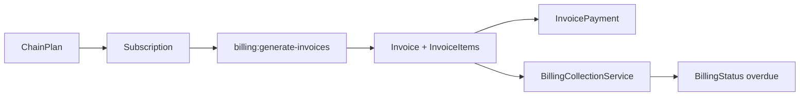

# Dominio: Facturación SaaS

Facturación de Sline a las cadenas (tenants). **No confundir** con pagos de pedidos del cliente final.

## Modelos

| Modelo | Función |
|---|---|
| `Plan` | Plan SaaS (starter, pro, enterprise) |
| `ChainPlan` | Plan asignado a cadena |
| `Subscription` | Suscripción activa |
| `Invoice` | Factura mensual |
| `InvoiceItem` | Líneas factura |
| `InvoicePayment` | Pagos recibidos |

## Planes

Campos clave en `plans`:
- `monthly_price_mxn` — cuota fija
- `fee_percentage` — comisión por pedido
- `max_branches` — límite sucursales
- `params` — JSON configuración extra

Enums: `PlanType`, `PlanCode`

Seeder: `PlanSeeder` (siempre corre)

## Flujo de facturación



## Servicios

| Service | Función |
|---|---|
| `SubscriptionBillingService` | Genera facturas periódicas |
| `BillingCollectionService` | Gestión cobranza, overdue |
| `InvoiceCollectionService` | Queries y filtros |
| `InvoicePaymentService` | Registrar pagos |
| `InvoicePaymentsExcel` | Export Excel |

## Command programado

```bash
vendor/bin/sail artisan billing:generate-invoices
```

Schedule: daily 02:00

## Configuración

`config/billing.php`:
```php
'overdue_days_warning' => 7,
'overdue_days_suspend' => 30,
// etc.
```

## Panel Admin

### Resources
- `Subscriptions/SubscriptionResource`
- `Invoices/InvoiceResource`
- `InvoicePayments/InvoicePaymentResource`

### Pages/Widgets
- `BillingDashboard` — overview
- `BillingOverview`, `BillingClientsTable` widgets

## Comisiones por pedido

Cada `Order` tiene campo `sline_fee` calculado según `fee_percentage` del plan.

Visible en:
- Reportes sucursal (`BranchOrderStatistics`)
- Stats financieras Franquicia

## Estados

Enum: `BillingStatus` — draft, sent, paid, overdue, cancelled

## Relación con operación

Si una cadena tiene facturas muy vencidas, puede afectar `ChainStatus` (suspendida) → bloquea tienda via `EnsureChainIsOperational`.

## Archivos clave

```
app/Services/SubscriptionBillingService.php
app/Services/BillingCollectionService.php
app/Console/Commands/GenerateSubscriptionInvoices.php
app/Filament/Resources/Invoices/
app/Filament/Pages/BillingDashboard.php
config/billing.php
database/seeders/DemoBillingSeeder.php
tests/Feature/BillingCollectionTest.php
```

## Debugging billing

| Problema | Verificar |
|---|---|
| No se generan facturas | Schedule, command manual, subscription activa |
| Monto incorrecto | Plan params, pedidos del periodo |
| Overdue no aplica | config/billing.php thresholds |
| Cadena suspendida | BillingCollectionService + ChainStatus |

```bash
vendor/bin/sail artisan billing:generate-invoices --dry-run  # si existe
vendor/bin/sail artisan tinker --execute 'App\Models\Invoice::latest()->first()'
```

## Añadir concepto a factura

1. Modificar `SubscriptionBillingService` — lógica de cálculo
2. Añadir InvoiceItem type si necesario
3. Actualizar InvoiceResource infolist en Admin
4. Test en `BillingCollectionTest.php`
