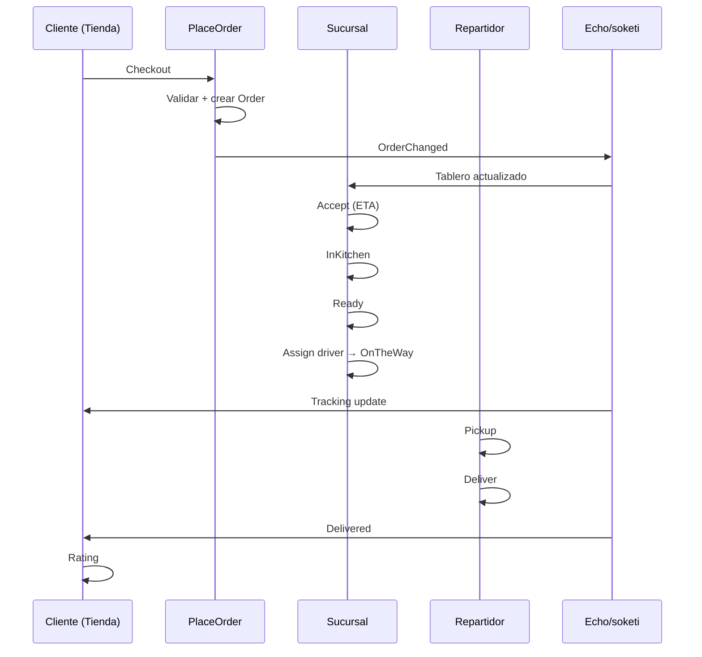

# Dominio: Pedidos

## Resumen

El pedido es la entidad central del negocio. Conecta cliente, sucursal, repartidor y pagos.

## Modelos

| Modelo | Tabla | Función |
|---|---|---|
| `Order` | `orders` | Pedido principal |
| `OrderItem` | `order_items` | Líneas del pedido (snapshots) |
| `OrderStatusHistory` | `order_status_history` | Auditoría transiciones |
| `Payment` | `payments` | Transacción pago |
| `Rating` | `ratings` | Calificación post-entrega |
| `ChatMessage` | `chat_messages` | Chat tracking |

## Estados (OrderStatus)

```
Pending          → Recién creado, esperando sucursal
Accepted         → Sucursal aceptó, definió ETA
InKitchen        → En preparación
ReadyForPickup   → Listo para entrega/recogida
OnTheWay         → Repartidor en camino (solo delivery)
Delivered        → Entregado/recogido
Rejected         → Rechazado por sucursal
Cancelled        → Cancelado
```

Enum: `app/Enums/OrderStatus.php`

## Tipos de entrega

| Tipo | Enum | Diferencias |
|---|---|---|
| Delivery | `OrderDeliveryType::Delivery` | Dirección, envío, repartidor |
| Pickup | `OrderDeliveryType::Pickup` | Sin dirección/envío/repartidor |
| Dine-in | `OrderDeliveryType::DineIn` | Comer en sucursal; sin envío ni repartidor |

## Flujo delivery completo



## Flujo pickup

```
Pending → Accepted → InKitchen → ReadyForPickup → Delivered (picked-up)
```

Sin repartidor. Acción: `POST /sucursal/orders/{order}/picked-up`

## Servicio principal: PlaceOrder

Archivo: `app/Services/PlaceOrder.php`

Responsabilidades:
1. Validar branch operacional
2. Resolver productos efectivos
3. Validar modificadores disponibles
4. Calcular: subtotal, envío, descuento, comisión Sline
5. Procesar pago
6. Crear Order + OrderItems con snapshots
7. Dispatch OrderChanged + SendOrderNotification

## Snapshots en OrderItem

Los items guardan estado al momento del pedido:
- `product_name_snapshot` — nombre efectivo sucursal
- `unit_price` — precio + modificadores
- Modificadores como JSON

Esto preserva historial aunque el menú cambie después.

## Transiciones desde sucursal

Controller: `SucursalOrderController.php`

| Acción | Status resultante | Notas |
|---|---|---|
| accept | Accepted | Requiere prep_minutes |
| in-kitchen | InKitchen | — |
| ready | ReadyForPickup | — |
| assign | OnTheWay | Asigna driver_id |
| picked-up | Delivered | Solo pickup |
| reject | Rejected | Motivo opcional |

**Nota:** assign driver cambia inmediatamente a `OnTheWay` (no se queda en ReadyForPickup).

## Realtime

Event: `OrderChanged` → broadcast `order.changed`

Canales:
- `branch.{branch_id}.orders` — tablero sucursal
- `order.{order_id}` — tracking cliente

## Pagos

| Método | Flujo |
|---|---|
| Cash | Sin procesamiento externo; repartidor cobra al entregar |
| Card | StripeGateway al checkout; captura al entregar |

Ver [Stripe](../external/stripe.md).

## Cupones

Modelo: `Coupon` + `CouponRedemption`  
Validación en PlaceOrder: branch, fechas, monto mínimo, límite usos.

## Pedidos programados

Campo `scheduled_for` en `orders` (nullable timestamp UTC).

| Pieza | Rol |
|---|---|
| `App\Support\ScheduledOrderTime` | Timezone de cadena, ventana válida (mín. 2 h, máx. 7 días), parse/storage/label |
| `Order::isScheduleLocked()` | `true` si `scheduled_for` existe y `now() < scheduled_for` |
| UI tienda | `schedule-picker.tsx` en checkout |
| UI sucursal | `board.tsx` / `order.tsx` muestran `scheduled_for_label` y estado de lock |

Mientras está locked, la sucursal ve el pedido pero las transiciones de preparación respetan la lógica de schedule en controller/props.

## Vista Franquicia

Resource: `Orders/OrderResource` (módulo `orders`, solo `view`).  
Página: `Orders/Pages/ViewOrder` — detalle de pedido en panel cadena.

## Mensajes (chat pedido)

| Ruta | Quién |
|---|---|
| `POST /sucursal/orders/{order}/messages` | Sucursal → `SucursalController::storeMessage` |
| `POST /t/{chain}/seguimiento/{order}/messages` | Cliente → `TiendaController::storeMessage` |

Persisten en `chat_messages` y broadcast via `ChatMessageSent`.

## Comisiones

Campo `sline_fee` en Order — porcentaje del plan de la cadena.

## Archivos clave

```
app/Services/PlaceOrder.php
app/Support/ScheduledOrderTime.php
app/Http/Controllers/Sucursal/SucursalOrderController.php
app/Http/Controllers/Sucursal/SucursalController.php
app/Http/Controllers/Tienda/TiendaController.php
app/Filament/Franquicia/Resources/Orders/
app/Events/OrderChanged.php
app/Enums/OrderStatus.php, OrderDeliveryType.php
resources/js/pages/sucursal/board.tsx, order.tsx
resources/js/pages/tienda/checkout.tsx, tracking.tsx
resources/js/components/tienda/schedule-picker.tsx
tests/Feature/TiendaTest.php, SucursalPortalTest.php
```

## Debugging pedidos

Ver [Depuración](../development/debugging.md) y [Panel de pedidos sucursal](../sucursal/order-panel.md).

## Tests demo

Seeder: `SucursalOrderDemoSeeder` — pedidos DEMO1-DEMO6 con distintos estados.

```bash
vendor/bin/sail artisan db:seed --class=SucursalOrderDemoSeeder
```
