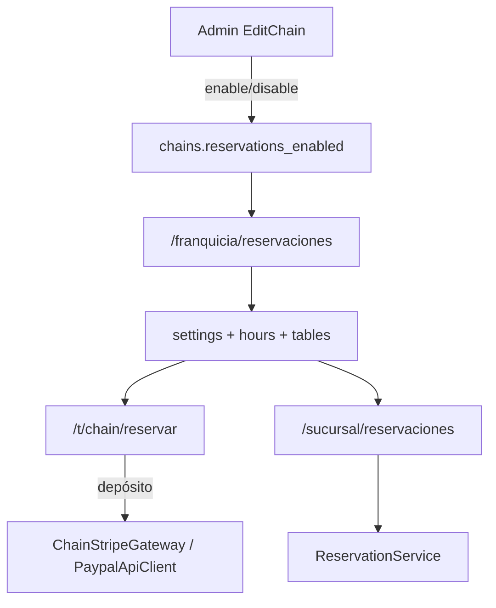

# Dominio: Reservaciones

Módulo end-to-end de mesas: flag por cadena, configuración en Franquicia, operación en Sucursal, booking + depósito en Tienda.

## Feature flag

| Pieza | Path / detalle |
|---|---|
| Columnas | `chains.reservations_enabled`, `reservations_enabled_at`, `reservations_disabled_at` |
| Gate | `Chain::isReservationsEnabled()` → `reservations_enabled === true` |
| Service | `app/Services/ChainReservationsModuleService.php` |

`ChainReservationsModuleService`: `canEnable` / `canDisable` / `enable` / `disable` / `stats` / `resolveOwner`.  
UI admin: `EditChain` + `ChainReservationsForm` (panel Admin Sline).

Activación por sucursal: `Branch::hasActiveReservations()` ↔ `branch_reservation_settings.is_active`.

## Auth (importante)

**No hay módulo `reservations` en `config/chain-permissions.php`.**

| Superficie | Gate |
|---|---|
| `BranchReservationResource` | Trait `CanManageFranquiciaReservations`: `UserType::Chain` + `ChainRole` (`owner`\|`manager`\|`admin`) + flag cadena |
| Stats reservaciones | `statistics.view` + flag (`CanViewFranquiciaReservationStatistics`) |
| Sucursal / Tienda | Flag cadena + sucursal con settings activos |

Enum roles: `app/Enums/ChainRole.php`.

## Modelos

| Modelo | Tabla | Path |
|---|---|---|
| `Reservation` | `reservations` | `app/Models/Reservation.php` |
| `BranchReservationSetting` | `branch_reservation_settings` | `app/Models/BranchReservationSetting.php` |
| `BranchReservationHour` | `branch_reservation_hours` | `app/Models/BranchReservationHour.php` |
| `BranchReservationTable` | `branch_reservation_tables` | `app/Models/BranchReservationTable.php` |

### `Reservation`

Campos clave: `branch_id`, `customer_id`, `public_code` (auto `R-###`), contacto, `party_size`, `reserved_at`, `duration_minutes` (default 120), `slot_count`, `status`, `branch_reservation_table_id`, notas, rechazo, deposit (`deposit_amount`, `deposit_payment_method`, `deposit_payment_intent_id`, `deposit_status`), timestamps (`accepted_at`, `seated_at`, `completed_at`, …).

Relaciones: `branch()`, `customer()`, `table()`, `acceptedBy()`, `rejectedBy()`.  
Scopes: `pending()`, `forDate()`, `active()` (Pending/Confirmed/Seated).  
Máquina de estados: `transitionTo(ReservationStatus)`.

### `BranchReservationSetting` (1:1 sucursal)

`is_active`, party size, `max_advance_days`, `auto_reject_when_full`, floor plan (`floor_plan_path/width/height`), depósito (`deposit_type/amount/percentage`), cancelación, `allowed_payment_methods` JSON, toggles notificación / campos opcionales, `activated_at`.

### `BranchReservationHour`

`day_of_week` (0–6), `opens_at`/`closes_at`, `is_closed`, `slot_durations_minutes` JSON, `slot_interval_minutes`, `allow_multiple_slots`, `max_slots_per_booking`. Unique `(branch_id, day_of_week, opens_at)`.

### `BranchReservationTable`

`code`, `name`, `capacity`, `shape_type`, posición/tamaño/`rotation`, `is_active`, `sort_order`. Unique `(branch_id, code)`.

## Enums

| Enum | Cases (valor) |
|---|---|
| `ReservationStatus` | `pending`, `confirmed`, `seated`, `completed`, `rejected`, `cancelled`, `no_show` |
| `ReservationDepositType` | `none`, `fixed`, `per_person`, `percentage` |
| `ReservationRejectionReason` | `NoTablesAvailable`, `BranchClosed`, `ExceedsCapacity`, `Other` |
| `ReservationTableShape` | `rectangle`, `circle` |
| `ReservationTableMapState` | `available`, `reserved`, `occupied` |

Paths: `app/Enums/Reservation*.php`.

Transiciones (`ReservationStatus::allowedTransitions()`):

```
Pending    → Confirmed | Rejected | Cancelled
Confirmed  → Seated | Completed | Cancelled | NoShow
Seated     → Completed | Cancelled
Terminales → Completed, Rejected, Cancelled, NoShow
```

## Franquicia: configuración

Resource: `BranchReservations/BranchReservationResource`  
Modelo UI: `Branch` (no `Reservation`)  
Slug: `reservaciones` → `/franquicia/reservaciones`, `/{record}/edit`  
Grupo: Operación · Trait: `CanManageFranquiciaReservations` · `canCreate/canDelete` = false

| Pieza | Detalle |
|---|---|
| Form | `BranchReservationForm` + `ReservationFloorPlanEditor` |
| Floor plan PHP | `app/Filament/Forms/Components/ReservationFloorPlanEditor.php` |
| Floor plan React | `resources/js/filament/reservation-floor-plan-editor.tsx` |
| Persist | `BranchReservationTableSyncService` + `BranchReservationSettingsService` |
| Hours RM | `ReservationHoursRelationManager` |
| Tables RM | archivo existe; mesas se editan por floor plan, no como RM registrado |

Header: Guardar y activar / Desactivar via `BranchReservationSettingsService`.

## Services

| Service | Rol |
|---|---|
| `PlaceReservation` | Alta booking cliente + validación |
| `ReservationService` | accept, reject, assignTable, seat, complete, rejectExcessPending |
| `ReservationAvailabilityService` | Disponibilidad / conflictos / mapa en instante |
| `ReservationSlotService` | Slots, ventana, validación |
| `ReservationCapacityService` | Capacidad mesas / overlapping |
| `ReservationMapStateService` | `stateAt()`, `previewForDay()` |
| `ReservationCalendarService` | Calendario sucursal |
| `ReservationHistoryService` | Historial terminal |
| `ReservationTableSuggestionService` | Sugerencia mesas en accept |
| `ReservationStatisticsService` | KPIs cadena/sucursal |
| `ReservationNotifier` | Push staff, email cliente, reminders (branded; ver [Correos](./emails.md)) |
| `ReservationBranchCoverageService` | Cobertura geo / cards sucursal |
| `ReservationDepositService` | Métodos web + inicio Stripe/PayPal |
| `BranchReservationSettingsService` | Draft / activate / deactivate |
| `BranchReservationTableSyncService` | Sync layout → DB |
| `ChainReservationsModuleService` | Flag cadena on/off |

Paths: `app/Services/Reservation*.php` (+ settings/sync/module).

Pagos depósito (tienda): `ReservationDepositService` → `ChainStripeGateway` / `PaypalApiClient`.  
Interface `ReservationDepositGateway` existe (`StripeReservationDepositGateway` / `FakeReservationDepositGateway`) pero el flujo live de tienda no la inyecta — ver [Pasarela por tenant](../external/chain-payment-gateway.md).

## Tienda — booking

Controller: `TiendaReservationController`  
Rutas: `routes/tienda.php` (grupo `auth` + `chain.operational`)

| Método | Path | Nombre |
|---|---|---|
| `GET` | `/t/{chain}/reservar` | `tienda.reservations.index` |
| `POST` | `/t/{chain}/reservar/resolve` | `tienda.reservations.resolve` |
| `GET` | `/t/{chain}/reservar/sucursales` | `tienda.reservations.branches` |
| `GET` | `/t/{chain}/reservar/{branch}` | `tienda.reservations.branch` |
| `GET` | `/t/{chain}/reservar/{branch}/slots` | `tienda.reservations.slots` |
| `POST` | `/t/{chain}/reservar/{branch}/borrador` | `tienda.reservations.draft` |
| `GET` | `/t/{chain}/reservar/{branch}/resumen` | `tienda.reservations.summary` |
| `POST` | `/t/{chain}/reservar/{branch}` | `tienda.reservations.store` |
| `GET` | `/t/{chain}/reservar/exito/{reservation}` | `tienda.reservations.success` |
| `GET` | `/t/{chain}/reservar/{branch}/pago/{reservation}` | `tienda.reservations.payment` |
| `POST` | `/t/{chain}/reservar/{branch}/pago/{reservation}` | `tienda.reservations.pay` |
| `GET` | `.../pago/{reservation}/paypal/return` | `tienda.reservations.paypal.return` |
| `GET` | `.../pago/{reservation}/paypal/cancel` | `tienda.reservations.paypal.cancel` |
| `GET` | `.../pago/{reservation}/stripe` | `tienda.reservations.stripe.payment` |
| `POST` | `.../pago/{reservation}/stripe/complete` | `tienda.reservations.stripe.complete` |

Inertia: `resources/js/pages/tienda/reservations/{wizard,branches,summary,payment,success}.tsx` (+ `tienda/stripe-payment.tsx`).

Depósito: métodos desde `allowed_payment_methods` filtrados por `ChainPaymentSettingsService`; Stripe → PaymentIntent manual capture (`Authorized`); PayPal → order + capture (`Paid`).

## Sucursal — operación

Ver detalle de UI y flujo: [Reservaciones Sucursal](../sucursal/reservations.md).

Canal realtime: `branch.{branch}.reservations` (`routes/channels.php`).  
Evento: `ReservationChanged`.

## Estadísticas

`ReservationStatisticsPage` → `/franquicia/estadisticas-reservaciones`  
Gate: flag + `statistics.view`.  
Detalle: [Estadísticas Franquicia](../panels/franquicia-statistics.md).

## Diagrama



## Ver también

- [Reservaciones Sucursal](../sucursal/reservations.md)
- [Pasarela por tenant](../external/chain-payment-gateway.md)
- [Stripe global](../external/stripe.md)
- [Panel Franquicia](../panels/franquicia.md)
