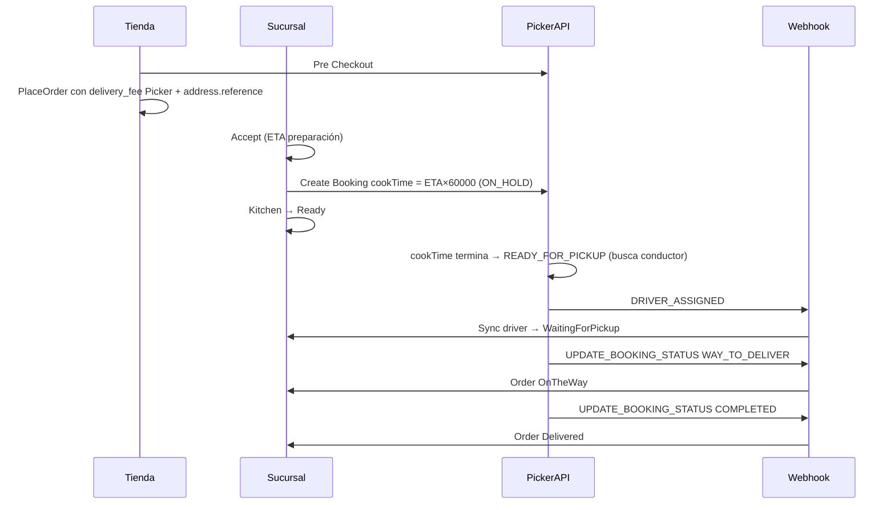

# Integración: Picker Express

Documentación canónica de la flota de delivery **Picker Express** en Sline.

Docs oficiales: [Picker API Suite](https://app.theneo.io/pickerexpress/picker-api-suite/por-donde-empezar).

> Antes este archivo se indexaba como “formularios / pickers UI”. Ese significado **ya no aplica**.

## Qué es y qué no es

| | Flota in-house (app repartidor) | Picker Express |
|---|---|---|
| Conductor | `User` tipo driver de la cadena | Conductor de proveedor; se sync a `User` driver por teléfono en `DRIVER_ASSIGNED` |
| Asignación | Modal **Asignar repartidor** (solo conductor, sin etiquetas) | Al **Aceptar** se crea el booking (`cookTime` = ETA); el webhook asigna/sincroniza el conductor |
| Tarifa checkout | `base_delivery_fee` + `per_km_fee` | **Pre Checkout** de Picker |
| Tracking | GPS / app Sline | Webhooks + opcional link Picker |
| Modelo | `orders.driver_id` | `shipments` con `platform=picker` + `driver_id` synced |

En **flota propia** solo se selecciona el conductor; el backend asigna internamente `platform=propia`. Didi/Uber/Other son etiquetas exclusivas del modo manual externo (sin API), nunca se muestran ni se envían para flota propia.

## Conceptos Picker ↔ Sline

| Picker | Sline |
|---|---|
| Empresa / Workspace + **Master Key** | `Chain` + `ChainPickerSetting` |
| Local + **Api Key** | `Branch` + `BranchPickerSetting` |
| Booking | `Order` (delivery) + `Shipment` (`platform=picker`) |
| Webhooks `DRIVER_ASSIGNED` / `UPDATE_BOOKING_STATUS` | `POST /api/v1/integrations/picker/webhook/{branch}` |

## Configuración

### Variables de entorno

```env
PICKER_SANDBOX_BASE_URL=https://dev-api.pickerexpress.com
PICKER_PRODUCTION_BASE_URL=https://api.pickerexpress.com
PICKER_TIMEOUT=15
PICKER_CONTENT_LANGUAGE=es
```

`config/services.php` → `services.picker.*`. El ambiente por cadena (`sandbox` | `production`) elige la base URL.

Dashboards: [Sandbox](https://dev-dashboard.pickerexpress.com/) · [Producción](https://dashboard.pickerexpress.com/).

### Franquicia → Administración → Picker Express

Resource: `PickerIntegrationResource` (`/franquicia/picker-express`)

RBAC módulo: `picker` (`view`, `edit`) — grupo Administración.

1. **Master Key / Empresa** (acción en header): guarda `ChainPickerSetting` (enabled, environment, master_key cifrado).
2. Por **sucursal**:
   - Activar + pegar Api Key, o **Sincronizar local** (`Create Store` con Master Key → guarda Api Key).
   - **Registrar webhooks** (`POST /api/webhooks` con `{ type, url }` para `DRIVER_ASSIGNED` y `UPDATE_BOOKING_STATUS`). Si falla, revisa Desarrollo → Logs Picker. La URL registrada debe ser pública (no `localhost`); usa `APP_URL` con un túnel/HTTPS alcanzable por Picker.

URL registrada por local:

```
POST {APP_URL}/api/v1/integrations/picker/webhook/{branchId}
```

## Flujo operativo



### 1. Cotización en tienda (`/t/{slug}`)

- Endpoint: `POST /t/{slug}/{branch}/delivery-quote` (`latitude`, `longitude`, `payment_method` opcional).
- Si la sucursal tiene Picker configurado → Pre Checkout; fee = `baseFare + perKmCharge`.
- Si no → fee Sline (`base_delivery_fee` + `per_km_fee`).
- `PlaceOrder` **re-cotiza** server-side (no confía solo en el cliente).
- Checkout React muestra “Envío” (sin mencionar Picker al cliente) y refleja la cotización al elegir dirección.
- Campo **Referencias de envío** (`address.reference`) se guarda en el snapshot y se envía a Picker como `reference`. Las instrucciones del pedido van en `notes` → `bookingNotes`.

`paymentMethod` hacia Picker: `CASH` si el pedido es efectivo; `CARD` si ya se cobra en Sline (Stripe/PayPal).

### 2. Cocina y despacho → Picker

Flujo UI en `/sucursal`: **Aceptar (ETA → booking)** → Cocina → Listo. Flota propia: **Asignar repartidor**.

1. `POST .../accept` con `prep_minutes` (ETA preparación): acepta el pedido y, si la sucursal usa courier Picker, llama `DispatchPickerBooking` con `cookTime = prep_minutes × 60000` (ms). El booking nace en `ON_HOLD` hasta cumplirse el tiempo ([docs Create Booking](https://app.theneo.io/pickerexpress/picker-api-suite/api-reference/bookings/create-booking)).
2. `POST .../ready` solo deja el pedido en `ready_for_pickup` (no crea booking).
3. Si el booking falló al aceptar, aparece **Reintentar envío** (`POST .../dispatch-picker`) con el `cookTime` restante hasta `estimated_ready_at` (o `0` si ya venció).
   - El teléfono se normaliza en `PickerBookingService`: se envían 10 dígitos en `customerMobile` + `customerCountryCode=+52` (se quita el prefijo `52`/`521` si ya venía incluido, evita `INVALID_PHONE`).
   - `Shipment` `platform=picker` se crea en `Pending` al aceptar; el pedido local sigue en cocina hasta que el webhook asigne conductor.
   - Cuando llega `DRIVER_ASSIGNED`, el pedido pasa a `waiting_for_pickup` y se sincroniza el conductor (nombre/teléfono).
   - El pedido avanza a `on_the_way` con `WAY_TO_DELIVER` / `ARRIVED_AT_DELIVERY`.
   - **Anti-duplicado**: si el pedido ya tiene un booking activo (`hasActivePickerBooking()`), **Reintentar envío** no aparece y un segundo `dispatch-picker` responde con error `picker`.
   - Si createBooking falla al aceptar → el pedido queda `accepted` y el error se muestra; en listo aparece **Reintentar envío**.
   - Si `PROVIDER_NOT_FOUND` → shipment `Cancelled`, reaparece **Reintentar envío**.
4. Sucursales con **flota propia** (`use_own_delivery`): botón **Asignar repartidor** → `POST .../assign` (platform `Propia`):
   - El modal muestra **únicamente la lista de repartidores**; no muestra ni envía Didi/Uber/Other/Propia.
   - El request envía solo `driver_id`; el backend fija `ShipmentPlatform::Propia`.
   - Pedido → `waiting_for_pickup` (**En espera de recolección**), shipment → `Assigned` (aún no `picked_up_at`).
   - **Marcar en camino** (`POST .../on-the-way`) o el pickup del repartidor en la app → pedido `on_the_way` + shipment `OnTheWay`.
5. Sucursales con **etiqueta de plataforma** (Didi/Uber/Other, sin API): `assign` deja el pedido directo en `on_the_way` (no hay recolección rastreable).

### Estado `waiting_for_pickup` (En espera de recolección)

Estado intermedio entre `ready_for_pickup` y `on_the_way`, **solo para delivery** (Picker o flota propia). Nueva columna en el tablero de sucursal.

- **Picker**: se establece con `DRIVER_ASSIGNED` (`ACCEPTED` / `ARRIVED_AT_PICKUP`). Mientras el booking está en `ON_HOLD` / buscando, el pedido puede seguir en cocina/listos con badge de delivery. Avanza a `on_the_way` con `WAY_TO_DELIVER` / `ARRIVED_AT_DELIVERY`.
- **Flota propia**: se establece al asignar repartidor; la sucursal (botón **Marcar en camino**) o la app del repartidor lo mueve a `on_the_way`.

Transiciones: `ready_for_pickup → [waiting_for_pickup, on_the_way, delivered, cancelled]`, `waiting_for_pickup → [on_the_way, delivered, cancelled]`.

### 3. Webhooks

Controller: `PickerWebhookController` (sin Sanctum; resuelve branch con `withoutGlobalScopes` + setea `CurrentTenant`).

| Evento / status Picker | Order | Shipment |
|---|---|---|
| READY_FOR_PICKUP / ON_HOLD | (sin cambio forzado de order) | Pending |
| ACCEPTED / DRIVER_ASSIGNED | WaitingForPickup (si la transición lo permite) + sync/crea `User` driver por teléfono | Assigned + `driver_id` |
| ARRIVED_AT_PICKUP | WaitingForPickup | Assigned |
| WAY_TO_DELIVER / ARRIVED_AT_DELIVERY | OnTheWay | OnTheWay |
| COMPLETED | Delivered | Delivered |
| PROVIDER_NOT_FOUND | ReadyForPickup (queda para manual) | Cancelled |
| CANCELLED_* | Cancelled si la máquina lo permite | Cancelled |
| NOT_DELIVERED / RETURNING / RETURNED | Sin cancelar order automáticamente | Cancelled + payload |

Idempotencia: mismo `picker_status` → solo actualiza payload.

Cancelación / rechazo desde sucursal con booking activo: `CancelPickerBookingForOrder` → Cancel Booking API + `syncCancelled`.

### 4. Tracking cliente

En `/t/{slug}/seguimiento/{order}` se exponen datos del shipment Picker: conductor, teléfono, `tracking_url`, `validation_code`.

El link de seguimiento en vivo viene del Create Booking como `data.smrURL` + query `uid=<customerId>` (sin `uid` el SMR responde `Missing param userID`). Fallback: `bookingDetailUrl` / `trackingUrl`.

UI: iframe con URL opaca misma-origen (`/t/{slug}/seguimiento/{order}/live`); el vendor URL viaja cifrado y se resuelve solo en el gateway. El payload Inertia usa `courier` (sin `picker`, sin host del vendor).

## Persistencia

### `chain_picker_settings`

- `chain_id` unique, `enabled`, `environment`, `master_key` (encrypted)

### `branch_picker_settings`

- `tenant_id`, `branch_id` unique, `enabled`, `api_key` (encrypted)
- `external_store_id`, `webhooks_registered_at`, `last_sync_error`

### `shipments` (columnas Picker)

`picker_booking_id`, `picker_booking_numeric_id`, `picker_external_id`, `picker_status`, `picker_provider`, `picker_driver_name`, `picker_driver_phone`, `picker_tracking_url`, `picker_validation_code`, `picker_last_payload_json`

Enum: `ShipmentPlatform::Picker = 'picker'`.

### `picker_api_logs`

Bitácora técnica visible en:

- **Franquicia → Desarrollo → Logs Picker** (`/franquicia/picker-api-logs`) — permiso módulo `picker.view`, scoped a la cadena
- **Admin → Desarrollo → Logs Picker** (`/admin/picker-api-logs`) — solo `AdminRole::Owner` (todas las cadenas)

Campos:

- `direction`: `outbound` | `inbound`
- `operation`, `method`, `url`, `status_code`, `successful`, `message`, `duration_ms`
- `request_headers_json` / `request_body_json` / `response_body_json` (secrets redactados)
- `tenant_id`, `branch_id` opcionales

## Servicios

| Clase | Rol |
|---|---|
| `App\Services\Picker\PickerClient` | HTTP Bearer + content-language |
| `ChainPickerSettingsService` / `BranchPickerSettingsService` | CRUD settings (blank secret preserve) |
| `PickerStoreService` | Create / Get Store(s) |
| `PickerWebhookService` | Get / Add Webhook |
| `PickerQuoteService` | Pre Checkout |
| `PickerBookingService` | Create / Get / Cancel Booking |
| `PickerApiLogger` | Persiste request/response en `picker_api_logs` |
| `DispatchPickerBooking` | Orquesta booking desde assign (o reintento) |
| `SyncPickerDriverFromWebhook` | Match/crea Driver por teléfono en `DRIVER_ASSIGNED` |
| `ApplyPickerWebhook` | Mapeo estados + broadcast `OrderChanged` |
| `CancelPickerBookingForOrder` | Cancel en reject |

## Archivos clave

```
app/Services/Picker/*
app/Models/ChainPickerSetting.php
app/Models/BranchPickerSetting.php
app/Filament/Franquicia/Resources/PickerIntegration/
app/Filament/Franquicia/Resources/PickerApiLogs/                 # Franquicia Desarrollo (picker.view)
app/Filament/Resources/PickerApiLogs/                        # Admin Desarrollo (Owner)
app/Http/Controllers/Api/PickerWebhookController.php
app/Models/PickerApiLog.php
app/Services/Picker/PickerApiLogger.php
app/Http/Controllers/Sucursal/SucursalOrderController.php  # ready, dispatchPicker, markOnTheWay, assign
app/Http/Controllers/Tienda/TiendaController.php             # deliveryQuote, tracking
routes/api.php
routes/tienda.php
routes/sucursal.php
config/services.php                                         # picker.* + PICKER_ADD_WEBHOOK_PATH
config/chain-permissions.php                               # módulo picker
```

Tests: `PickerQuoteTest`, `DispatchPickerBookingTest`, `PickerWebhookTest`, `PickerIntegrationResourceTest`, `PickerApiLogTest`.

## Checklist certificación Picker

Según [Certificación](https://app.theneo.io/pickerexpress/picker-api-suite/certificacion):

- [ ] Pre Checkout + Create Booking con datos de cliente/dirección/teléfono correctos
- [ ] `paymentMethod` CASH vs CARD según cobro
- [ ] Webhooks registrados e interpretación de estados
- [ ] Cancel Booking (reject/cancel en Sline)
- [ ] Create Store / sync de locales (Master Key)
- [ ] Visualización de estados y tracking para el cliente final
- [ ] Reunión de certificación con Picker antes de producción

## Debugging

| Problema | Revisar |
|---|---|
| Cotización falla en tienda | Api Key branch, ambiente, lat/lng, logs ValidationException `delivery` |
| Accept no crea booking | Picker enabled + Api Key, Logs Picker, toast/flash `picker`; ETA/`prep_minutes` → `cookTime` ms |
| Create Booking falla con `INVALID_PHONE` | Teléfono con prefijo duplicado; `PickerBookingService::normalizeCustomerMobile` deja 10 dígitos + `+52` |
| Reintentar envío duplica el booking | Verifica `hasActivePickerBooking()` (acepta id numérico); un segundo `dispatch-picker` responde error `picker` |
| DRIVER_ASSIGNED sin driver_id | Teléfono vacío en payload; `SyncPickerDriverFromWebhook` |
| Pedido no pasa a En camino | Picker: espera `WAY_TO_DELIVER`; flota propia: **Marcar en camino** o pickup del repartidor |
| Webhook 200 pero sin cambio | `picker_booking_id` / `externalBookingID` match, `CurrentTenant`, status ya aplicado |
| Sync Store falla | Master Key enabled, dirección/geo de Branch, `last_sync_error` |
| Register webhook Not Found | Api Key del local, sandbox vs prod, `PICKER_ADD_WEBHOOK_PATH`, **Franquicia/Admin → Desarrollo → Logs Picker** (URL + HTTP) |
| Assign bloqueado | Ya hay booking Picker activo; espera el webhook `DRIVER_ASSIGNED` |

```bash
php artisan test --compact tests/Feature/PickerQuoteTest.php tests/Feature/DispatchPickerBookingTest.php tests/Feature/PickerWebhookTest.php tests/Feature/PickerIntegrationResourceTest.php tests/Feature/PickerApiLogTest.php
```

## Fuera de alcance (MVP)

- Pre-Booking (solo sandbox / certificación Picker)
- Sustituir app repartidor Sline
- Cobro del costo Picker en billing SaaS
- Auto-Create Store al crear Branch (solo acción «Sincronizar»)
