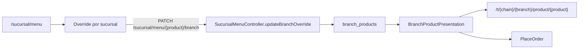

# Overrides De Producto Por Sucursal

Este documento describe el flujo de datos para editar productos desde el portal de sucursal sin modificar el menú maestro de franquicia.

## Objetivo

Una sucursal puede personalizar ciertos datos visibles de un producto solo para esa sucursal. Por ejemplo, el producto maestro puede llamarse `Coca-Cola`, pero en la sucursal 1 puede mostrarse como `Coca dieta sucursal`.

El producto maestro sigue existiendo como fuente principal. El override solo se aplica cuando el producto se consulta dentro del contexto de una sucursal específica.

## Campos Que Puede Sobrescribir La Sucursal

Los overrides de contenido se guardan en `branch_products`:

- `name_override`
- `description_override`
- `tax_rate_override`
- `calories_override`
- `tags_override`
- `image_path_override`
- `images_override`
- `price_override`
- `is_available`
- `available_from`
- `available_to`

Estos campos se editan desde el bloque **Override por sucursal** en:

```text
sline-webapp/resources/js/pages/sucursal/menu.tsx
```

## Campos Que No Son Override

Estos datos pertenecen al menú maestro de franquicia y no se guardan como override de sucursal:

- `sku`
- `category_id`
- `base_price`
- `is_active`
- `sort_order`

Si se cambian, deben guardarse con **Guardar en franquicia**. Si se guarda con **Guardar en sucursal**, no se envían como override.

## Tabla Principal

Los overrides se almacenan en:

```text
branch_products
```

La migración que agrega los campos de contenido es:

```text
sline-webapp/database/migrations/2026_06_10_000001_add_product_content_overrides_to_branch_products_table.php
```

Antes de probar overrides en un entorno nuevo, confirmar que la migración ya corrió:

```bash
vendor/bin/sail artisan migrate:status
vendor/bin/sail artisan migrate
```

## Flujo De Guardado

El usuario entra a:

```text
GET /sucursal/menu
```

La pantalla muestra cada producto con tres grupos de datos:

- Datos efectivos: lo que se muestra en la tabla.
- `franchise_product`: datos originales del maestro.
- `branch_override`: datos guardados específicamente para la sucursal.

Al presionar **Guardar en sucursal**, el frontend manda solo los campos permitidos de `branch_override` a:

```text
PATCH /sucursal/menu/{product}/branch
```

El controlador que recibe el request es:

```text
sline-webapp/app/Http/Controllers/Sucursal/SucursalMenuController.php
```

El método relevante es:

```text
updateBranchOverride()
```

Este método valida los campos de sucursal, normaliza valores vacíos y actualiza `branch_products`.

## Servicio Central

La lógica compartida vive en:

```text
sline-webapp/app/Services/BranchProductPresentation.php
```

Este servicio centraliza:

- Buscar el override correcto para `product_id` + `branch_id`.
- Resolver datos efectivos del producto.
- Detectar si existe override real de contenido.
- Convertir el request de sucursal a columnas de `branch_products`.
- Evaluar ventana de disponibilidad por sucursal.

La idea es que menú, tienda y checkout usen la misma forma de calcular el producto efectivo.

## Flujo De Lectura En Tienda

Cuando un cliente abre:

```text
GET /t/{chain}/{branch}/product/{product}
```

Por ejemplo:

```text
/t/pollo-crazy/1/product/8
```

Laravel resuelve:

- `chain`: cadena/franquicia por slug.
- `branch`: sucursal por id.
- `product`: producto maestro.

Luego `TiendaController` carga los overrides de esa sucursal:

```text
sline-webapp/app/Http/Controllers/Tienda/TiendaController.php
```

En la página de producto, el payload usa valores efectivos:

- `name`: `name_override` si existe, si no `products.name`.
- `description`: `description_override` si existe, si no `products.description`.
- `price`: `price_override` si existe, si no `products.base_price`.
- `images`: `images_override` si existe, si no `products.images`.
- `tags`: `tags_override` si existe, si no `products.tags`.
- `calories`: `calories_override` si existe, si no `products.calories`.

## Flujo De Datos



## Etiqueta Solo Sucursal

La etiqueta **Solo sucursal** aparece cuando existe override real de contenido.

No debe aparecer solo por cambios operativos como:

- `is_available`
- `available_from`
- `available_to`

Sí aparece si existe diferencia en:

- Nombre
- Descripción
- Impuesto
- Calorías
- Tags
- Galería
- Precio sucursal

## Imágenes Privadas

Las imágenes se guardan en disco local privado y se sirven con rutas autenticadas para sucursal o rutas específicas de tienda.

Rutas relacionadas:

```text
GET /sucursal/menu/{product}/image/{image?}
GET /t/{chain}/{branch}/product/{product}/image/{image?}
```

La primera imagen de la galería se usa como portada.

## Checkout

Al crear un pedido, `PlaceOrder` también consulta el producto efectivo por sucursal.

Esto asegura que el snapshot del pedido use el nombre y precio correctos:

- `product_name_snapshot`: nombre efectivo.
- `unit_price`: precio efectivo más modificadores.

Así, si la sucursal muestra `Coca dieta sucursal`, el pedido conserva ese nombre en el snapshot.

## Resumen De Reglas

- **Guardar en franquicia** modifica el producto maestro.
- **Guardar en sucursal** modifica solo `branch_products`.
- Tienda siempre muestra el producto efectivo para la sucursal de la URL.
- Checkout usa el mismo producto efectivo que tienda.
- Si la migración de overrides no está aplicada, no se podrán guardar `name_override`, `description_override`, galería, tags ni otros campos de contenido.
